# Manual Book Aplikasi Tiket APP

**Untuk admin dan operator · Versi 1.0 · Dibuat 3 Oktober 2026**

Dokumen ini berisi panduan lengkap penggunaan aplikasi Tiket APP. Semua isi di sini
disusun berdasarkan tampilan dan aturan yang benar-benar ada di aplikasi, bukan
rencana. Nama menu, nama tombol, dan nama status ditulis **persis seperti yang
terlihat di layar**.

---

## Daftar Isi

1. [Pendahuluan](#1-pendahuluan)
2. [Struktur Aplikasi](#2-struktur-aplikasi)
3. [Group dan Akun](#3-group-dan-akun)
4. [Matriks Akses](#4-matriks-akses)
5. [Urutan Penggunaan yang Disarankan](#5-urutan-penggunaan-yang-disarankan)
6. [Istilah dan Status](#6-istilah-dan-status)
7. [Panduan Umum](#7-panduan-umum)
8. [Panduan per Group](#8-panduan-per-group)
   - [8.1 GROUP_ADMIN — Administrator](#81-group_admin--administrator)
   - [8.2 GROUP_EVENT — Operator Event](#82-group_event--operator-event)
   - [8.3 GROUP_OFFICER — Petugas Gerbang](#83-group_officer--petugas-gerbang)
   - [8.4 GROUP_MERCH — Operator Merchandise](#84-group_merch--operator-merchandise)
   - [8.5 GROUP_MARKETING — Operator Pemasaran](#85-group_marketing--operator-pemasaran)
   - [8.6 GROUP_FINANCE — Keuangan](#86-group_finance--keuangan)
9. [Alur End-to-End Lintas Group](#9-alur-end-to-end-lintas-group)
10. [Temuan dan Catatan](#10-temuan-dan-catatan)

---

## 1. Pendahuluan

### 1.1 Tujuan aplikasi

Aplikasi Tiket APP adalah sistem internal untuk mengelola penjualan **tiket event**,
**merchandise**, dan **iklan**, beserta seluruh catatan **keuangan**nya. Aplikasi ini
dipakai oleh staff untuk menyiapkan, memantau, dan mengawal penjualan — bukan oleh
pembeli.

### 1.2 Batas cakupan (penting)

- Aplikasi ini **khusus untuk admin dan operator** (petugas internal).
- **Tampilan untuk pembeli belum tersedia.** Tidak ada halaman pendaftaran pembeli,
  halaman checkout, keranjang belanja, atau pembayaran dari sisi pembeli di aplikasi
  ini. Modul "Discovery" (Home, Event List, News List, Promo List) adalah **katalog
  baca-saja** untuk staff internal, bukan halaman pembeli.
- Modul Merchandise yang tersedia adalah sisi **penjual/petugas** (Product Data,
  Seller Order, My Purchase). Sisi pembeli tidak ada.
- Tidak ada tombol **beli**, **checkout**, atau **bayar** di halaman katalog mana pun.

### 1.3 Cara membaca manual ini

- **Teks tebal** seperti **Tambah** adalah nama tombol di layar. Klik tombol dengan nama
  persis tersebut.
- Tulisan seperti `Event Data` adalah nama menu. Menu berada di sidebar kiri, dikelompokkan
  dalam modul dan *menu induk* (contoh: **Module Event** → *Event Management* →
  **Event Data**).
- Label bertanda (wajib) berarti isian tersebut harus diisi. Label tanpa (wajib) boleh
  dikosongkan.
- Bagian **Aturan penting** menjelaskan hal yang **tidak boleh** dilakukan agar data tidak
  rusak.
- Penanda `[Tangkapan layar: ...]` adalah tempat gambar sebaiknya dipasang. Gambar
  disediakan oleh tim dokumentasi, bukan oleh dokumen ini.
- Semua contoh data (kode event, nama, nomor rekening) bersifat **fiktif**.

---

## 2. Struktur Aplikasi

Aplikasi memiliki **7 modul** dan **47 menu** (menu yang bisa dibuka). Semua 47 menu
sudah tersedia.

### 2.1 Pohon menu

```
Module System (19 menu)
├── User Access
│   ├── User Login
│   └── User Group
├── Module Setup
│   ├── Module List
│   └── Menu List
├── Master Data
│   ├── Category Data
│   ├── City Data
│   ├── Bank Data
│   ├── Payment Method
│   └── Fee Setting
├── Security Center
│   ├── Security Setting
│   ├── Session List
│   └── Blocked Access
├── Log Center
│   ├── Audit Log
│   ├── System Log
│   └── Login History
├── Broadcast Message
│   ├── Send Message
│   └── Message History
└── App Setting
    ├── General Setting
    └── Notification Template

Module Discovery (6 menu)
├── Home
├── Event Catalog
│   ├── Event List
│   ├── Event by Category
│   └── Event by City
└── Info Center
    ├── News List
    └── Promo List

Module Event (3 menu)
└── Event Management
    ├── Event Data
    ├── Ticket Type
    └── Attendee List

Module Ticketing (4 menu)
├── Ticket Order
│   ├── My Ticket
│   └── Ticket Refund
└── Ticket Check-in
    ├── Scan Ticket
    └── Scan History

Module Merchandise (4 menu)
├── Merchandise Shop
│   ├── Product List
│   └── My Purchase
└── Seller Center
    ├── Product Data
    └── Seller Order

Module Marketing (4 menu)
├── Marketing Tools
│   ├── Promo Code
│   └── Ad Campaign
└── Content Management
    ├── News Data
    └── News Category

Module Finance (7 menu)
├── Transaction
│   ├── Payment History
│   └── Invoice List
├── Organizer Finance
│   ├── Sales Report
│   └── Payout Request
├── Seller Finance
│   ├── Seller Balance
│   └── Withdrawal
└── Bank Account
```

### 2.2 Jumlah menu per module

| Module | Menu induk | Jumlah menu | Status |
|---|---|---|---|
| Module System | User Access, Module Setup, Master Data, Security Center, Log Center, Broadcast Message, App Setting | 19 | Tersedia |
| Module Discovery | Event Catalog, Info Center (+ Home langsung) | 6 | Tersedia |
| Module Event | Event Management | 3 | Tersedia |
| Module Ticketing | Ticket Order, Ticket Check-in | 4 | Tersedia |
| Module Merchandise | Merchandise Shop, Seller Center | 4 | Tersedia |
| Module Marketing | Marketing Tools, Content Management | 4 | Tersedia |
| Module Finance | Transaction, Organizer Finance, Seller Finance (+ Bank Account langsung) | 7 | Tersedia |
| **TOTAL** | | **47** | **47 tersedia, 0 belum** |

---

## 3. Group dan Akun

Hak akses per grup disimpan sebagai daftar menu. Setiap grup juga mewarisi baris *menu
induk* supaya menu anaknya bisa tampil di sidebar — itu sebabnya jumlah baris akses di
database lebih besar daripada jumlah menu.

| Nama Group | Kode Group | Fungsi | Contoh username akun | Jumlah menu |
|---|---|---|---|---|
| Administrator | `GROUP_ADMIN` | Mengatur seluruh sistem: akun, group, master data, keamanan, log, pesan, pengaturan aplikasi | `admin` | 19 |
| Operator Event | `GROUP_EVENT` | Menyusun event, tipe tiket, peserta; menerbitkan tiket; menangani refund; memantau katalog | `event` | 11 |
| Petugas Gerbang | `GROUP_OFFICER` | Memindai tiket di pintu masuk dan melihat riwayat pindai | `officer` | 2 |
| Operator Merchandise | `GROUP_MERCH` | Mengelola penjual dan produk, mencatat dan mengirim pesanan merch | `merch` | 5 |
| Operator Pemasaran | `GROUP_MARKETING` | Mengelola kode promo, iklan, berita, dan kategori berita | `marketing` | 8 |
| Keuangan | `GROUP_FINANCE` | Mencatat pembayaran, invoice, saldo penjual, penarikan, payout, laporan penjualan | `finance` | 7 |

> **Catatan keamanan.** Password setiap akun diberikan terpisah oleh tim pengembang dan
> **wajib diganti sebelum dipakai di production**. Password akun demo sengaja dibuat
> lemah dan hanya untuk pengujian.

Selain itu ada group `GROUP_SUPPORT` (**Support**) yang sudah ada di sistem tetapi
**tidak punya akun dan tidak punya hak akses menu apa pun**, sehingga tidak muncul di
sidebar siapa pun. Grup ini tidak dibahas di manual ini.

---

## 4. Matriks Akses

✅ = boleh dibuka · — = tidak punya akses (menu tidak muncul di sidebar, dan halaman
ditolak jika dibuka)

| # | Module | Menu | MCONTROL | ADMIN | EVENT | OFFICER | MERCH | MARKETING | FINANCE |
|---|---|---|---|---|---|---|---|---|---|
| 1 | System | User Login | `cp_userlogin` | ✅ | — | — | — | — | — |
| 2 | System | User Group | `cp_usergroup` | ✅ | — | — | — | — | — |
| 3 | System | Module List | `cp_matrix` | ✅ | — | — | — | — | — |
| 4 | System | Menu List | `cp_menu` | ✅ | — | — | — | — | — |
| 5 | System | Category Data | `cp_category` | ✅ | — | — | — | — | — |
| 6 | System | City Data | `cp_city` | ✅ | — | — | — | — | — |
| 7 | System | Bank Data | `cp_bank` | ✅ | — | — | — | — | — |
| 8 | System | Payment Method | `cp_paymentmethod` | ✅ | — | — | — | — | — |
| 9 | System | Fee Setting | `cp_fee` | ✅ | — | — | — | — | — |
| 10 | System | Security Setting | `cp_security` | ✅ | — | — | — | — | — |
| 11 | System | Session List | `cp_session` | ✅ | — | — | — | — | — |
| 12 | System | Blocked Access | `cp_blocked` | ✅ | — | — | — | — | — |
| 13 | System | Audit Log | `cp_auditlog` | ✅ | — | — | — | — | — |
| 14 | System | System Log | `cp_syslog` | ✅ | — | — | — | — | — |
| 15 | System | Login History | `cp_loginhistory` | ✅ | — | — | — | — | — |
| 16 | System | Send Message | `cp_message_send` | ✅ | — | — | — | — | — |
| 17 | System | Message History | `cp_message_history` | ✅ | — | — | — | — | — |
| 18 | System | General Setting | `cp_setting` | ✅ | — | — | — | — | — |
| 19 | System | Notification Template | `cp_notification_template` | ✅ | — | — | — | — | — |
| 20 | Discovery | Home | `mhome` | — | ✅ | — | ✅ | ✅ | — |
| 21 | Discovery | Event List | `meventlist` | — | ✅ | — | — | ✅ | — |
| 22 | Discovery | Event by Category | `meventcategory` | — | ✅ | — | — | — | — |
| 23 | Discovery | Event by City | `meventcity` | — | ✅ | — | — | — | — |
| 24 | Discovery | News List | `mnewslist` | — | ✅ | — | — | ✅ | — |
| 25 | Discovery | Promo List | `mpromolist` | — | ✅ | — | — | ✅ | — |
| 26 | Event | Event Data | `meventdata` | — | ✅ | — | — | — | — |
| 27 | Event | Ticket Type | `mtickettype` | — | ✅ | — | — | — | — |
| 28 | Event | Attendee List | `mattendee` | — | ✅ | — | — | — | — |
| 29 | Ticketing | My Ticket | `mmyticket` | — | ✅ | — | — | — | — |
| 30 | Ticketing | Ticket Refund | `mrefund` | — | ✅ | — | — | — | — |
| 31 | Ticketing | Scan Ticket | `mscanticket` | — | — | ✅ | — | — | — |
| 32 | Ticketing | Scan History | `mscanhistory` | — | — | ✅ | — | — | — |
| 33 | Merchandise | Product List | `mproduct` | — | — | — | ✅ | — | — |
| 34 | Merchandise | My Purchase | `mmypurchase` | — | — | — | ✅ | — | — |
| 35 | Merchandise | Product Data | `mproductdata` | — | — | — | ✅ | — | — |
| 36 | Merchandise | Seller Order | `msellerorder` | — | — | — | ✅ | — | — |
| 37 | Marketing | Promo Code | `mpromocode` | — | — | — | — | ✅ | — |
| 38 | Marketing | Ad Campaign | `mcampaign` | — | — | — | — | ✅ | — |
| 39 | Marketing | News Data | `mnewsdata` | — | — | — | — | ✅ | — |
| 40 | Marketing | News Category | `mnewscategory` | — | — | — | — | ✅ | — |
| 41 | Finance | Payment History | `mpayment` | — | — | — | — | — | ✅ |
| 42 | Finance | Invoice List | `minvoice` | — | — | — | — | — | ✅ |
| 43 | Finance | Sales Report | `msales` | — | — | — | — | — | ✅ |
| 44 | Finance | Payout Request | `mpayout` | — | — | — | — | — | ✅ |
| 45 | Finance | Seller Balance | `mbalance` | — | — | — | — | — | ✅ |
| 46 | Finance | Withdrawal | `mwithdraw` | — | — | — | — | — | ✅ |
| 47 | Finance | Bank Account | `mbank` | — | — | — | — | — | ✅ |

Jumlah per group: **ADMIN 19 · EVENT 11 · OFFICER 2 · MERCH 5 · MARKETING 8 · FINANCE 7**
(total 72 penugasan akses dari 47 menu).---

## 5. Urutan Penggunaan yang Disarankan

Urutan ini mengikuti kondisi data yang ada di sistem. Kerjakan dari atas ke bawah.

| Tahap | Group | Module & Menu | Tujuan |
|---|---|---|---|
| 1. Siapkan master data | GROUP_ADMIN | System > Master Data: **Category Data**, **City Data**, **Bank Data**, **Payment Method** | Kode kategori event, kota, bank, dan metode pembayaran harus ada sebelum ada event atau transaksi |
| 2. Tentukan tarif | GROUP_ADMIN | System > Master Data: **Fee Setting** | Menentukan biaya platform, biaya layanan, biaya penarikan, minimum penarikan, masa tunggu payout, dan batas bayar |
| 3. Tetapkan aturan login | GROUP_ADMIN | System > Security Center: **Security Setting** | Menentukan panjang password, batas gagal login, durasi blokir, dan batas sesi |
| 4. Isi identitas aplikasi | GROUP_ADMIN | System > App Setting: **General Setting** | Nama aplikasi, slogan, kontak, logo, dan pengaturan email pengirim (dipakai untuk kirim tiket dan refund) |
| 5. Siapkan pesan otomatis | GROUP_ADMIN | System > App Setting: **Notification Template** | Judul dan isi email untuk tiket terbit, refund disetujui, pesanan dikirim, payout dan penarikan berhasil |
| 6. Susun akses tim | GROUP_ADMIN | System > User Access: **User Group**, lalu **User Login** | Buat group sesuai tanggung jawab, centang menu, lalu buat akun untuk tiap petugas |
| 7. Susun merchandise | GROUP_MERCH | Merchandise > Seller Center: **Product Data** | Buat penjual dan produk (dengan stok, harga, gambar) sebelum ada pesanan |
| 8. Susun event | GROUP_EVENT | Event > Event Management: **Event Data** | Buat event sebagai Draft, isi lokasi, jadwal, dan poster |
| 9. Susun tiket | GROUP_EVENT | Event > Event Management: **Ticket Type** | Buat minimal satu tipe tiket aktif (syarat wajib untuk menerbitkan event) |
| 10. Terbitkan event | GROUP_EVENT | Event > Event Management: **Event Data** > **Publish** | Event masuk katalog (Event List dan Home) setelah semua syarat terpenuhi |
| 11. Siapkan promosi | GROUP_MARKETING | Marketing > Marketing Tools: **Promo Code**, **Ad Campaign** | Kode diskon dan slot iklan (opsional, tidak menghambat penjualan) |
| 12. Terapkan pengumuman | GROUP_MARKETING | Marketing > Content Management: **News Category**, lalu **News Data** | Kategori berita dulu, lalu tulis dan terbitkan berita |
| 13. Catat pembayaran | GROUP_FINANCE | Finance > Transaction: **Payment History** > **Catat** | Pembayaran tiket, merchandise, atau iklan membuat tiket jadi **LUNAS** dan invoice terbit otomatis |
| 14. Rekap keuangan | GROUP_FINANCE | Finance > Transaction: **Invoice List**, Organizer Finance: **Sales Report** | Invoice siap cetak; laporan penjualan menjadi bahan pengajuan payout |
| 15. Hari pelaksanaan | GROUP_OFFICER dan GROUP_EVENT | Ticketing > Ticket Check-in: **Scan Ticket**; Event > Event Management: **Attendee List** | Petugas gerbang memindai, operator memantau kehadiran |
| 16. Tangani refund | GROUP_EVENT | Ticketing > Ticket Order: **Ticket Refund** | Pengajuan, persetujuan atau penolakan, dan penyelesaian refund |
| 17. Kirim merchandise | GROUP_MERCH | Merchandise > Seller Center: **Seller Order** | Proses, input resi dan kirim, tangani keluhan atau pengembalian |
| 18. Cairkan uang | GROUP_FINANCE | Seller Finance: **Withdrawal**, Organizer Finance: **Payout Request** | Penarikan saldo penjual dan pencairan hasil penjualan ke penyelenggara |
| 19. Pantau keamanan | GROUP_ADMIN | System > Log Center: **Audit Log**, **System Log**, **Login History**; Security Center: **Session List**, **Blocked Access**; Broadcast Message: **Send Message**, **Message History** | Pengawasan rutin dan komunikasi internal |

---

## 6. Istilah dan Status

### 6.1 Istilah umum

| Istilah | Arti |
|---|---|
| **Event** | Kegiatan yang tiketnya dijual (konser, festival, olahraga, dan sejenisnya) |
| **Tipe tiket** | Jenis tiket di dalam satu event, punya harga, kuota, dan batas per orang |
| **Kuota** | Jumlah tiket yang boleh terjual untuk satu tipe tiket |
| **Terjual** | Tiket yang status tiketnya **AKTIF** dan pembayarannya **LUNAS** |
| **Sisa kuota** | Kuota dikurangi tiket terjual |
| **Peserta (attendee)** | Satu orang pemegang satu tiket |
| **Kode tiket** | Kode unik tiket, contoh: `T-7KD92M4XQ1` |
| **QR tiket** | Kode QR di dalam tiket; dipakai untuk check-in di pintu masuk |
| **Penyelenggara** | Pemilik event (diisi pada menu Event Data) |
| **Penjual (seller)** | Penjual merchandise di modul Merchandise |
| **Invoice** | Bukti tagihan yang terbit otomatis setiap ada pembayaran berhasil |
| **Payout** | Pencairan hasil penjualan tiket ke rekening penyelenggara |
| **Withdrawal** | Penarikan saldo penjualan merchandise oleh penjual |
| **Fee** | Potongan biaya yang dihitung dari pengaturan **Fee Setting** |
| **Buku besar (ledger)** | Catatan saldo penjual (PENDING dan AVAILABLE), bukan saldo manual |
| **MCONTROL** | Kode internal menu, contoh `meventdata`, dipakai saat meminta bantuan teknis |

### 6.2 Status Event

| Status | Arti |
|---|---|
| `DRAFT` | Baru dibuat, belum tampil di katalog |
| `PUBLISHED` | Sudah tayang di katalog (Event List dan Home) |
| `ENDED` | Sudah selesai; diisi otomatis oleh sistem setelah tanggal selesai terlewati |
| `CANCELLED` | Dibatalkan oleh operator dengan alasan tertentu |

### 6.3 Status Tiket dan Kehadiran

| Status | Arti |
|---|---|
| `AKTIF` | Tiket sah dan ikut menghitung kuota |
| `DIBATALKAN` | Tiket tidak berlaku lagi; kuota kembali ke tipe tiket |
| `BELUM_BAYAR` | Peserta sudah terdaftar, pembayaran belum dicatat |
| `LUNAS` | Pembayaran sudah dicatat oleh Finance |
| `REFUND` | Sudah dikembalikan dananya |
| `BELUM_HADIR` | Belum check-in di pintu |
| `HADIR` | Sudah check-in di pintu masuk |

Status **tipe tiket** dihitung otomatis dari tanggal jual dan kuota: `TERSEDIA`
(Tersedia), `HAMPIR_HABIS` (Hampir habis), `SOLD_OUT` (Sold out), `BELUM_DIBUKA`
(Penjualan belum dibuka), `DITUTUP` (Penjualan ditutup), `TIDAK_AKTIF` (Tidak aktif).

### 6.4 Status Pembayaran

| Status | Arti |
|---|---|
| `BERHASIL` | Pembayaran tercatat penuh |
| `DIBATALKAN` | Pembayaran dibatalkan; status pembayaran sumber dikembalikan menjadi **BELUM_BAYAR** |
| Sumber `MANUAL` | Dicatat manual oleh Finance |
| Sumber `IMPOR` | Hasil import peserta |
| Sumber `BACKFILL` | Pencatatan susulan |
| Refund `DIKEMBALIKAN` atau `SEBAGIAN` | Besaran yang sudah dikembalikan |

### 6.5 Status Pesanan Merchandise

| Status | Arti |
|---|---|
| `BARU` | Pesanan dibuat, belum diproses |
| `DIPROSES` | Sedang disiapkan penjual |
| `DIKIRIM` | Sudah dikirim, resi tercatat |
| `SELESAI` | Diterima pembeli |
| `DIBATALKAN` | Dibatalkan; stok kembali |
| `DIKEMBALIKAN` | Dikembalikan ke penjual |

Status keluhan: `TERBUKA` lalu `DITANGGAPI` lalu `SELESAI`.

### 6.6 Status Refund Tiket

| Status | Arti |
|---|---|
| `DIAJUKAN` | Diajukan, menunggu keputusan |
| `DISETUJUI` | Disetujui; tiket dibatalkan, kuota kembali, dana belum dikonfirmasi |
| `DITOLAK` | Ditolak; tiket tidak berubah |
| `SELESAI` | Dana sudah dikembalikan dan dicatat di modul Finance |

### 6.7 Status Payout dan Withdrawal

| Status | Arti |
|---|---|
| `DIAJUKAN` | Pengajuan dibuat; dana dikunci (khusus withdrawal) |
| `DIPROSES` | Sedang diproses transfer |
| `BERHASIL` | Transfer selesai, dana keluar |
| `GAGAL` | Transfer gagal, dana kembali |
| `DITOLAK` | Pengajuan ditolak, dana kembali |

### 6.8 Status Berita

| Status | Arti |
|---|---|
| `DRAFT` | Disusun, belum terbit |
| `TERJADWAL` | Terbit pada tanggal dan waktu yang ditentukan; otomatis menjadi **TERBIT** saat waktunya tiba |
| `TERBIT` | Sudah tayang di News List |
| `DIARSIPKAN` | Diturunkan dari tayang, tidak tampil di News List |

### 6.9 Status Promo

| Status | Arti |
|---|---|
| `BERLAKU` | Bisa dipakai sekarang |
| `AKAN_DATANG` | Belum mulai, masih dalam masa tunggu |
| `KEDALUWARSA` | Sudah lewat masa berlaku |
| `KUOTA_HABIS` | Kuota pemakaian habis |
| `NONAKTIF` | Dinonaktifkan oleh operator |

Jenis nilai promo: `PERSEN` (persentase) dan `NOMINAL` (potongan rupiah).
Cakupan promo: `SEMUA` (semua event), `KATEGORI` (per kategori event), `EVENT` (per event).

### 6.10 Status Iklan (Ad Campaign)

| Status | Arti |
|---|---|
| `DRAFT` | Baru dibuat, belum lunas |
| `MENUNGGU_BAYAR` | Sudah mengajukan bayar, menunggu catatan pembayaran Finance |
| `AKTIF` | Tayang; impressions dan klik mulai dihitung |
| `DIJEDA` | Dihentikan sementara, bisa dilanjutkan |
| `DIBATALKAN` | Status final, tidak bisa diubah |

Periode tampilan: `TERJADWAL` (akan tayang), `TAYANG` (sedang tayang), `SELESAI` (selesai).

---

## 7. Panduan Umum

### 7.1 Cara login

1. Buka alamat aplikasi di browser (Chrome atau Edge disarankan).
2. Isi **User Login** dan **Password**.
3. Klik **Login**.
4. Jika berhasil, muncul halaman beranda dengan daftar modul di sidebar kiri.

[Tangkapan layar: Halaman Login]

Jika muncul **"User atau Password salah.."**, periksa kembali huruf besar-kecil dan
karakter khusus. Akun yang dinonaktifkan tidak dapat login.

### 7.2 Sesi login dan sesi habis

- Sesi login punya batas waktu. Batasnya diatur di **Security Setting** melalui kolom
  **Habis tidak aktif (menit)** dan **Maksimum sesi (jam)**.
- Jika sesi habis, muncul dialog **"Login Kembali"**. Isi User Login dan Password lalu
  klik **Login**; tidak perlu keluar aplikasi.
- Jika Anda login ulang dengan akun berbeda, aplikasi dimuat ulang agar hak akses ikut
  menyesuaikan.
- Menu **Session List** (Group Admin) dapat mencabut sesi milik orang lain. Pengguna
  yang sesinya dicabut akan diminta login ulang pada permintaan berikutnya.
- **Sesi Anda sendiri tidak bisa dicabut** dari Session List. Gunakan logout biasa.

### 7.3 Mengganti password

1. Buka **User Login** (**Module System** > *User Access* > **User Login**). Hanya
   Group Admin yang punya menu ini.
2. Klik ikon **Ubah** pada baris akun yang akan diubah.
3. Isi kolom **Password** dengan password baru yang memenuhi kebijakan di **Security
   Setting**.
4. Klik **Simpan User**.

Aturan password mengikuti Security Setting. Nilai bawaannya:

| Aturan | Nilai bawaan |
|---|---|
| Panjang minimum | 8 karakter |
| Wajib huruf besar | Ya |
| Wajib angka | Ya |
| Wajib simbol | Tidak |

Jika tidak sesuai, muncul pesan seperti **"Password minimal 8 karakter."**,
**"Password wajib mengandung huruf besar."**, atau **"Password wajib mengandung angka."**
Password lama tidak pernah ditampilkan. Mengosongkan kolom password saat mengubah berarti
password **tidak** diubah.

### 7.4 Membaca tabel

- Setiap tabel punya kolom nomor (`#`) di kiri.
- Tombol **Refresh** (ikon di toolbar) memuat ulang data terbaru.
- **Paginasi**: gunakan **Prev** dan **Next** di bawah tabel untuk berpindah halaman.
- **Filter per kolom**: klik ikon filter pada kepala kolom, lalu ketik kata kunci. Setiap
  kolom bisa difilter terpisah.
- **Urutkan**: klik kepala kolom bertanda panah untuk mengurutkan naik atau turun. Tidak
  semua kolom bisa diurutkan.
- **Klik kanan** pada baris (mode Desktop) membuka menu cepat, misalnya **Ubah** atau
  **Hapus**.
- **Kartu ringkasan** di atas tabel menampilkan angka total dan ringkasan lain (mis.
  **Total tiket**, **Lunas**, **Hadir**).
- **Tooltip**: arahkan kursor ke ikon `i` atau tanda tanya untuk melihat penjelasan.

### 7.5 Filter, Terapkan, dan Reset

- Halaman yang memiliki filter biasanya punya baris filter berisi kolom pencarian,
  pilihan status, dan tombol **Terapkan**.
- **Terapkan** menjalankan filter sesuai isian. **Reset** mengembalikan filter ke kondisi
  awal sehingga seluruh data tampil kembali.
- Filter yang sedang aktif **disimpan** di sesi browser. Saat membuka halaman lagi, filter
  terakhir masih dipakai. Gunakan **Reset** bila ingin melihat semua data.
- Filter tanggal punya rentang default: bulan ini untuk menu Finance, 7 hari untuk
  Audit Log, 1 hari untuk System Log, 30 hari untuk Message History, dan hari ini untuk
  Scan History. Rentang maksimum umumnya **1 tahun**.

### 7.6 Notifikasi, konfirmasi, dan pesan error

- Setiap aksi yang mengubah data meminta konfirmasi, misalnya **"Simpan Event baru?"** atau
  **"Hapus kategori X?"**. Tombol berwarna merah dipakai untuk aksi berbahaya.
- Setelah berhasil muncul pesan **"Success"** seperti **"Event berhasil dibuat."**.
- Jika gagal, muncul pesan merah di atas halaman berisi alasan, misalnya **"Judul wajib
  diisi."**, **"Kuota tipe tiket tidak mencukupi (sisa 3)."**, atau **"Anda tidak memiliki
  hak akses untuk membuka menu ini."**
- Semua aksi tulis (tambah, ubah, hapus, perubahan status, ekspor) dicatat di **Audit Log**.

### 7.7 Inbox pesan

- Ikon **lonceng** di header menampilkan jumlah pesan belum dibaca.
- Klik lonceng untuk membuka inbox. Pesan prioritas **DARURAT** juga tampil sebagai banner
  di halaman.
- Pesan yang **ditarik** oleh pengirim akan hilang dari inbox Anda.
- Group Admin (**Send Message**) dapat mengirim pesan ke semua user aktif, ke group
  tertentu, atau ke user tertentu. Ada kolom **Berakhir tampil**; jika kosong, pesan
  tampil terus.
- **Message History** menampilkan riwayat semua pesan, jumlah penerima, jumlah yang sudah
  dibaca, dan menyediakan aksi **Tarik Pesan** (riwayat tetap ada, pesan hilang dari inbox).

### 7.8 Ekspor CSV

Tombol **Export CSV** tersedia di Audit Log, Login History, Scan History, Attendee List,
Payment History, Invoice List, Sales Report, Seller Balance, Payout Request, dan
Withdrawal. Berkas CSV dibatasi **10.000 baris**. Jika data lebih banyak, sistem
memberi tahu bahwa hasil diekspor sebagian dan filter sebaiknya diperkecil.---

## 8. Panduan per Group

Setiap bagian group berisi: **(a) Ringkasan**, **(b) Urutan kerja harian**, **(c) Panduan
per menu**, dan **(d) Hal yang tidak bisa dilakukan**.

Menu yang dipakai lebih dari satu group dijelaskan lengkap pada group pertama yang
memakainya. Di group lain cukup ditulis ringkas dengan tautan ke penjelasan lengkapnya.

---

### 8.1 GROUP_ADMIN — Administrator

#### a. Ringkasan

| Item | Isi |
|---|---|
| Tugas group | Mengatur seluruh sistem: akun, group, master data, keamanan, log, pesan, dan pengaturan aplikasi |
| Contoh username akun | `admin` |
| Password | Diberikan terpisah oleh tim pengembang; wajib diganti sebelum production |

Menu yang bisa diakses (19 menu, semuanya di **Module System**):

| Menu induk | Menu |
|---|---|
| *User Access* | **User Login**, **User Group** |
| *Module Setup* | **Module List**, **Menu List** |
| *Master Data* | **Category Data**, **City Data**, **Bank Data**, **Payment Method**, **Fee Setting** |
| *Security Center* | **Security Setting**, **Session List**, **Blocked Access** |
| *Log Center* | **Audit Log**, **System Log**, **Login History** |
| *Broadcast Message* | **Send Message**, **Message History** |
| *App Setting* | **General Setting**, **Notification Template** |

#### b. Urutan kerja harian

1. Login dengan akun `admin`. Sidebar hanya menampilkan **Module System**.
2. Buka **Module System > Log Center > Audit Log** untuk melihat perubahan data semalam
   (filter default 7 hari).
3. Buka **Module System > Log Center > Login History** untuk memeriksa login gagal dan
   akun yang diblokir.
4. Jika adawich generóate mencurigakan, buka **Module System > Security Center >
   Blocked Access** untuk membuka blokir, dan **Session List** untuk mencabut sesi.
5. Bila ada pengumuman, buka **Module System > Broadcast Message > Send Message**.
6. Bila ada permintaan setup (misalnya kode promo untuk event baru), siapkan dulu master
   data: **Category Data**, **City Data**, **Bank Data**, **Payment Method**, lalu
   **Fee Setting**.
7. Bila ada petugas baru, buka **Module System > User Access > User Group** lalu
   **User Login** untuk membuat akun.

#### c. Panduan per menu

##### User Login

- **Lokasi**: Module System > *User Access* > **User Login** (`cp_userlogin`)
- **Kegunaan**: kelola seluruh akun yang bisa masuk ke aplikasi.
- **Kapan dipakai**: membuat akun petugas baru, mengubah data atau status aktif akun,
  menghapus akun.
- **Langkah**:
  1. Klik **Create User** (tombol di toolbar) atau ikon **Ubah** pada baris yang akan diubah.
  2. Isi form, lalu klik **Save User**.
  3. Konfirmasi **Simpan User Login?**.
  4. Untuk menghapus, klik ikon hapus pada baris, konfirmasi **Hapus User Login: X?**
     lalu **Ya, Hapus**.
- **Isian dan filter**: kolom tabel **User Login**, **User Name**, **Group**, **Email**,
  **Aktif**. Form: **User Login** (wajib; tidak bisa diubah saat edit), **User Name**
  (wajib), **Email** (wajib), **Status Aktif** (YA/TIDAK), **Group** (daftar group),
  **Password** (wajib saat membuat). Filter per kolom tersedia di semua kolom teks dan
  kolom Aktif.
- **Status dan artinya**: kolom **Aktif** `YA` berarti boleh login, `TIDAK` berarti tidak
  bisa login.
- **Aturan penting dan hal yang tidak boleh dilakukan**:
  - Password disimpan dengan fungsi enkripsi database, bukan teks biasa.
  - Saat mengubah, kolom password yang dikosongkan berarti password **tidak** diubah.
  - Password harus memenuhi kebijakan **Security Setting**.
  - Group yang dipakai akun tidak boleh dihapus dari **User Group** selama masih dipakai.
- **Pesan error yang sering muncul**: **"Username dan Password wajib diisi."**,
  **"Username sudah dipakai."**, **"Password minimal 8 karakter."**,
  **"Password wajib mengandung huruf besar."**, **"Password wajib mengandung angka."**
- **Hubungan dengan menu lain**: pilihan **Group** diambil dari menu **User Group**.
  Akun ini yang menentukan menu mana yang muncul di sidebar.

##### User Group

- **Lokasi**: Module System > *User Access* > **User Group** (`cp_usergroup`)
- **Kegunaan**: membuat group dan menentukan menu mana yang boleh diakses tiap group.
- **Kapan dipakai**: ada petugas dengan tanggung jawab baru; ada perubahan tanggung jawab;
  ada staff yang perlu dibatasi.
- **Langkah**:
  1. Klik **Add Group**, ketik nama group pada jendela kecil, klik **OK**.
  2. Group baru muncul di kolom kiri. Klik baris group tersebut.
  3. Di panel kanan **Group Setting**, centang modul dan menu yang boleh diakses.
  4. Klik **Save Group Setting**, konfirmasi **Simpan pengaturan User Group?**
  5. Untuk menghapus, klik ikon hapus pada baris group, konfirmasi **Hapus User Group: X?**
     lalu **Ya, Hapus**.
- **Isian dan filter**: kolom tabel **Group**. Panel kanan punya kolom pencarian
  **Filter menu (nama/kode)** dan daftar modul_centang dengan penghitung "x/y".
  Group Name tidak bisa diubah.
- **Status dan artinya**: centang berarti **boleh**; tidak dicentang berarti **tidak boleh**.
- **Aturan penting dan hal yang tidak boleh dilakukan**:
  - Kode group hanya boleh huruf A-Z, tanda `-`, dan `_` (tanpa spasi dan tanpa huruf kecil).
  - Group yang tidak diberi akses menu sama sekali berarti aksesnya kosong.
  - Baris **menu induk** otomatis ikut tersimpan agar menu anak tampil di sidebar.
  - **Tidak boleh** mengosongkan semua akses group yang sedang dipakai.
  - Perubahan akses berlaku setelah pengguna login ulang (atau setelah menu disegarkan).
- **Pesan error yang sering muncul**: **"Nama Group tidak boleh kosong."**,
  **"Group User sudah ada."**, **"Hanya boleh huruf A-Z, '-' dan '_' (tanpa spasi, tanpa
  huruf kecil)."**
- **Hubungan dengan menu lain**: hasil setting di sini menentukan isi sidebar semua akun,
  dan menentukan boleh/tidaknya sebuah endpoint saat menu dibuka.

##### Module List

- **Lokasi**: Module System > *Module Setup* > **Module List** (`cp_matrix`)
- **Kegunaan**: melihat dan mengubah nama, urutan, dan ikon modul aplikasi.
- **Kapan dipakai**: perlu mengganti nama modul atau mengurutkan ulang tampilannya.
- **Langkah**:
  1. Klik ikon **Ubah** pada modul yang akan diubah.
  2. Ubah isian yang diperlukan, klik **Simpan**, konfirmasi **Simpan Module?**
- **Isian dan filter**: kolom **Urutan**, **Kode**, **Nama**, **Induk**, **Halaman**
  (dua kolom terakhir tidak bisa difilter). Form: **Kode** (tidak bisa diubah), **Nama**
  (wajib, maksimal 200 karakter), **Urutan** (wajib, angka bulat tidak negatif),
  **Ikon** (maksimal 100 karakter).
- **Status dan artinya**: tidak ada status; modul aktif ada di sidebar.
- **Aturan penting dan hal yang tidak boleh dilakukan**:
  - **Tidak ada tombol Tambah dan tidak ada tombol Hapus** pada halaman ini.
  - Kode modul, nama modul teknis, dan ID **tidak boleh** diubah.
  - Urutan tidak boleh sama dengan modul lain.
- **Pesan error yang sering muncul**: **"Nama module wajib diisi."**,
  **"Nama maksimal 200 karakter."**, **"Urutan sudah dipakai module lain."**
- **Hubungan dengan menu lain**: urutan modul menentukan urutan modul di sidebar.

##### Menu List

- **Lokasi**: Module System > *Module Setup* > **Menu List** (`cp_menu`)
- **Kegunaan**: melihat struktur menu per modul dan mengubah nama, urutan, serta status
  buka-tutup.
- **Kapan dipakai**: ingin mengganti nama menu di layar atau mengurutkan menu.
- **Langkah**:
  1. Pilih **Module** pada dropdown, atau ketik di kolom **Cari nama/control...**.
  2. Klik ikon **Ubah** pada menu yang akan diubah.
  3. Ubah isian, klik **Simpan**, konfirmasi **Simpan Menu?**
- **Isian dan filter**: kolom **Module** (dropdown), kolom pencarian **Cari nama/control...**.
  Form: **Kode** (tidak bisa diubah), **Control** (tidak bisa diubah), **Nama** (wajib,
  maksimal 40 karakter), **Urutan** (wajib, bilangan bulat tidak negatif), **Expand**
  (Terbuka atau Tertutup), **Akses** (jumlah group yang punya akses, tidak bisa diubah).
- **Status dan artinya**: **Expand** `TRUE` (Terbuka) atau `FALSE` (Tertupt).
- **Aturan penting dan hal yang tidak boleh dilakukan**:
  - **Tidak ada tombol Tambah dan tidak ada tombol Hapus.**
  - Kode menu, induk, modul, control, dan penanda anak **tidak boleh** diubah.
  - Urutan tidak boleh sama dengan menu lain di dalam modul yang sama.
- **Pesan error yang sering muncul**: **"Nama menu wajib diisi."**,
  **"Nama maksimal 40 karakter."**, **"Urutan sudah dipakai menu lain dalam grup ini."**
- **Hubungan dengan menu lain**: daftar menu di sini adalah sumber dataBehind sidebar dan
  sumber nama menu yang tampil di **User Group**.

##### Category Data

- **Lokasi**: Module System > *Master Data* > **Category Data** (`cp_category`)
- **Kegunaan**: mengelola kategori event, misalnya Konser, Festival, Olahraga, Workshop.
- **Kapan dipakai**: sebelum membuat event; saat menambah kategori baru untuk event.
- **Langkah**:
  1. Klik **Tambah** atau ikon **Ubah**.
  2. Isi form, klik **Simpan**, konfirmasi **Simpan Category?**
  3. Mengaktifkan atau menonaktifkan: ikon aktiv pada baris, konfirmasi
     **Nonaktifkan kategori X?**.
  4. Menghapus: ikon hapus, konfirmasi **Hapus kategori X?** lalu **Ya, Hapus**.
- **Isian dan filter**: kolom **Kode**, **Nama**, **Urutan**, **Aktif**. Form: **Kode**
  (wajib, maksimal 20 karakter, tidak bisa diubah saat edit), **Nama** (wajib, maksimal
  100 karakter), **Urutan** (opsional), **Status** (Aktif/Nonaktif).
- **Status dan artinya**: **Aktif** bisa dipilih di form Event Data; **Nonaktif** tidak
  muncul di dropdown tetapi datanya tetap ada.
- **Aturan penting dan hal yang tidak boleh dilakukan**:
  - Kode dan nama harus unik.
  - Kategori yang **sedang dipakai event tidak boleh dihapus** — sistem menolak dengan
    pesan **"Kategori `<nama>` sedang dipakai event, tidak boleh dihapus. Nonaktifkan saja."**
  - Gunakan **Nonaktifkan**, bukan Hapus, untuk kategori lama.
- **Pesan error yang sering muncul**: **"Kode dan Nama wajib diisi."**,
  **"Kode sudah dipakai kategori lain."**, **"Nama sudah dipakai kategori lain."**
- **Hubungan dengan menu lain**: dipakai oleh **Event Data** (dropdown kategori),
  **Event by Category**, dan **Promo Code** (cakupan KATEGORI).

##### City Data

- **Lokasi**: Module System > *Master Data* > **City Data** (`cp_city`)
- **Kegunaan**: mengelola kota beserta provinsi dan zona waktu.
- **Kapan dipakai**: sebelum membuat event di luar kota yang sudah ada.
- **Langkah**: sama dengan **Category Data** — **Tambah**, isi form, **Simpan**, konfirmasi
  **Simpan City?**; ikon aktiv untuk nonaktifkan/aktifkan; ikon hapus untuk menghapus.
- **Isian dan filter**: kolom **Kode**, **Kota**, **Provinsi**, **Zona**, **Aktif**. Form:
  **Kode** (wajib, maksimal 20 karakter), **Kota** (wajib, maksimal 100 karakter),
  **Provinsi** (wajib, maksimal 100 karakter), **Zona** (wajib, hanya WIB, WITA, WIT),
  **Status**.
- **Status dan artinya**: **Zona** dipakai untuk menampilkan jam lokal event pada katalog.
- **Aturan penting dan hal yang tidak boleh dilakukan**:
  - Nama kota unik **per provinsi**.
  - Kota yang sedang dipakai event **tidak boleh dihapus** — pesan
    **"Kota `<nama>` sedang dipakai event, tidak boleh dihapus. Nonaktifkan saja."**
- **Pesan error yang sering muncul**: **"Kode, Nama, Provinsi, dan Zona waktu wajib diisi."**,
  **"Nama kota sudah dipakai di provinsi ini."**, **"Zona waktu hanya boleh WIB, WITA, atau WIT."**
- **Hubungan dengan menu lain**: dipakai **Event Data** (dropdown kota), **Event by City**,
  dan filter kota di **Event List** serta **Event by Category**.

##### Bank Data

- **Lokasi**: Module System > *Master Data* > **Bank Data** (`cp_bank`)
- **Kegunaan**: daftar bank master beserta kode transfer.
- **Kapan dipakai**: sebelum membuat rekening (**Bank Account**) atau metode pembayaran VA.
- **Langkah**: **Tambah**, isi form, **Simpan**, konfirmasi **Simpan Bank?**; ikon hapus
  dengan konfirmasi **Hapus bank X?**
- **Isian dan filter**: kolom **Kode**, **Bank**, **Singkat**, **Aktif**. Form: **Kode**
  (wajib, hanya angka 3 sampai 5 digit, tidak bisa diubah saat edit), **Nama** (wajib,
  maksimal 100 karakter), **Singkat** (wajib, maksimal 20 karakter), **Status**.
- **Status dan artinya**: bank **Nonaktif** tidak muncul di dropdown **Bank Account** dan
  **Payment Method**.
- **Aturan penting dan hal yang tidak boleh dilakukan**:
  - Bank yang sudah dipakai rekening **tidak boleh dihapus**, hanya dinonaktifkan.
  - Kode hanya angka 3 sampai 5 digit.
- **Pesan error yang sering muncul**: **"Kode bank hanya angka 3 sampai 5 digit."**,
  **"Kode sudah dipakai bank lain."**,
  **"Bank `<nama>` sedang dipakai rekening, tidak boleh dihapus. Nonaktifkan saja."**
- **Hubungan dengan menu lain**: dipakai **Bank Account** (Finance) dan dropdown bank pada
  **Payment Method**.

##### Payment Method

- **Lokasi**: Module System > *Master Data* > **Payment Method** (`cp_paymentmethod`)
- **Kegunaan**: metode pembayaran yang boleh dipilihFinance saat mencatat pembayaran.
- **Kapan dipakai**: sebelum mencatat pembayaran pertama.
- **Langkah**:
  1. Klik **Tambah**.
  2. Isi form (bagian **Metode**, **Biaya**, **Logo**).
  3. Bila tipe **VA**, pilih **Bank**.
  4. Unggah logo bila perlu (JPG, PNG, atau WebP, maksimal 2MB).
  5. Klik **Simpan**, konfirmasi **Simpan Payment?**
- **Isian dan filter**: kolom **Kode**, **Nama**, **Tipe**, **Bank**, **%**, **Tetap**,
  **Minimum**, **Maksimum**, **Urutan**, **Aktif**. Form: **Kode** (wajib, maksimal
  20 karakter), **Nama** (wajib, maksimal 100 karakter), **Tipe** (wajib: QRIS, VA,
  EWALLET, CARD), **Bank** (wajib hanya bila tipe VA), **Urutan**, **Status**, **Persen**
  (0 sampai 100), **Tetap**, **Minimum**, **Maksimum**, file **Logo**.
- **Status dan artinya**: metode **Nonaktif** tidak muncul di form **Catat Pembayaran**.
- **Aturan penting dan hal yang tidak boleh dilakukan**:
  - Tipe hanya boleh QRIS, VA, EWALLET, atau CARD.
  - Maksimum harus lebih besar dari Minimum.
  - Metode yang sudah dipakai transaksi **tidak boleh dihapus**, hanya dinonaktifkan.
  - Logo hanya JPG, PNG, atau WebP maksimal 2MB.
- **Pesan error yang sering muncul**: **"Tipe hanya boleh QRIS, VA, EWALLET, atau CARD."**,
  **"Tipe VA wajib memilih bank."**, **"Maksimum harus lebih besar dari minimum."**,
  **"Logo hanya boleh JPG, PNG, atau WebP."**, **"Ukuran logo maksimal 2MB."**
- **Hubungan dengan menu lain**: dipakai **Payment History** untuk memilih metode dan
  menghitung biaya metode.

##### Fee Setting

- **Lokasi**: Module System > *Master Data* > **Fee Setting** (`cp_fee`)
- **Kegunaan**: mengatur seluruh biaya aplikasi. Setiap penyimpanan membuat **versi baru**
  yang berlaku sejak tanggal tertentu.
- **Kapan dipakai**: sebelum ada transaksi dan payout; saat kebijakan tarif berubah.
- **Langkah**:
  1. Klik **Ubah Pengaturan** atau klik kanan baris lalu **Duplikat sebagai versi baru**.
  2. Isi bagian **Berlaku & Catatan**, **Nilai**, dan **Ringkasan perubahan**.
  3. Klik **Simpan Versi**, konfirmasi **Buat versi berlaku <tanggal>?**
  4. Membatalkan versi mendatang: klik **Batalkan versi ini** pada kartu **Dijadwalkan**,
     konfirmasi, lalu **Ya, Batalkan**.
- **Isian dan filter**: kolom riwayat **Berlaku**, **Catatan**, **Status**, **Dibuat oleh**.
  Kartu **Pengaturan Saat Ini** menampilkan nilai berlaku: **Platform %**, **Platform tetap**,
  **Layanan/tiket**, **Penarikan**, **Tunggu payout**, **Batas bayar**. Form: **Mulai
  berlaku** (tanggal, default hari ini, tidak boleh di masa lalu), **Catatan** (wajib,
  maksimal 200 karakter), **Platform %** (0 sampai 100), **Platform tetap**, **Layanan/tiket**,
  **Biaya penarikan**, **Min. penarikan**, **Tunggu payout** (0 sampai 30 hari),
  **Batas bayar** (5 sampai 1440 menit).
- **Status dan artinya**: versi **Aktif** sedang berlaku; versi **Dijadwalkan** berlaku
  nanti; versi lama tidak berlaku dan tidak bisa diubah.
- **Aturan penting dan hal yang tidak boleh dilakukan**:
  - Tanggal mulai berlaku **tidak boleh** di masa lalu.
  - Tidak boleh ada dua versi aktif dengan tanggal yang sama atau lebih baru.
  - **Versi yang sudah berlaku tidak boleh dibatalkan.**
  - Minimum penarikan harus lebih besar dari biaya penarikan.
  - Perubahan tidak memengaruhi transaksi yang sudah tercatat.
- **Pesan error yang sering muncul**: **"Tanggal mulai berlaku tidak boleh di masa lalu."**,
  **"Sudah ada versi aktif bertanggal sama atau lebih baru. Batalkan versi mendatang dulu bila
  ingin menggantinya."**, **"Minimum penarikan harus lebih besar dari biaya penarikan."**,
  **"Masa tunggu payout 0 sampai 30 hari."**, **"Batas waktu bayar 5 sampai 1440 menit."**
- **Hubungan dengan menu lain**: dipakai **Payment History** (biaya platform dan layanan),
  **Payout Request** (masa tunggu payout), dan **Withdrawal** (biaya serta minimum penarikan).

##### Security Setting

- **Lokasi**: Module System > *Security Center* > **Security Setting** (`cp_security`)
- **Kegunaan**: mengatur kebijakan password, proteksi login, dan sesi.
- **Kapan dipakai**: kebijakan perusahaan berubah; ada insiden keamanan.
- **Langkah**:
  1. Ubah isian pada bagian **Kebijakan Password**, **Proteksi Login**, atau **Sesi**.
  2. Klik **Simpan**, konfirmasi **Simpan Pengaturan?**, lalu periksa tabel Lama/Baru.
  3. Untuk mengembalikan, klik **Reset**.
- **Isian dan filter**: tidak ada filter. Isian: **Panjang minimum** (6 sampai 64),
  **Wajib huruf besar**, **Wajib angka**, **Wajib simbol**, **Masa berlaku (hari)** (0 sampai
  365), **Batas gagal login** (3 sampai 10), **Durasi blokir (menit)** (1 sampai 1440),
  **Habis tidak aktif (menit)** (5 sampai 480), **Maksimum sesi (jam)** (1 sampai 72),
  **Maksimum per user** (0 sampai 20; 0 berarti tanpa batas).
- **Status dan artinya**: **Ya/Tidak** untuk tiga aturan ke wajiban.
- **Aturan penting dan hal yang tidak boleh dilakukan**:
  - Perubahan berlaku untuk kejadian berikutnya; sesi yang sedang berjalan tidak terputus.
  - Menurunkan nilai invalid akan ditolak, misalnya panjang minimum 2.
- **Pesan error yang sering muncul**: **"Panjang password minimum harus antara 6 dan
  64."**, **"Harus angka bulat 6 sampai 64."**, **"Pilihan wajib hanya YES atau NO."**
- **Hubungan dengan menu lain**: dipakai login (**User Login**), **Blocked Access**
  (blokir otomatis), dan **Session List** (batas sesi).

##### Session List

- **Lokasi**: Module System > *Security Center* > **Session List** (`cp_session`)
- **Kegunaan**: melihat sesi login yang sedang aktif dan mencabut sesi milik orang lain.
- **Kapan dipakai**: ada suspicions akun dipakai orang lain; setelah ganti password.
- **Langkah**:
  1. Isi filter bila perlu (**Dari**, **s.d.**, **User**, status, **IP**, **Cari**).
  2. Klik **Terapkan**.
  3. Untuk mencabut: klik ikon **Cabut sesi** pada baris, konfirmasi **Cabut sesi X? User
     diminta login ulang pada request berikutnya.** lalu **Ya, Cabut**.
- **Isian dan filter**: kolom **User**, **Login**, **Aktivitas Terakhir**, **IP**,
  **Perangkat**, **Status**. Kartu: **Sesi aktif**, **User aktif**. Baris sesi Anda sendiri
  diberi badge **Sesi Anda**.
- **Status dan artinya**: `AKTIF` (berjalan), `LOGOUT` (sudah keluar), `DICABUT` (dicabut
  manual), `KEDALUWARSA` (lewat masa berlaku atau idle).
- **Aturan penting dan hal yang tidak boleh dilakukan**:
  - **Sesi Anda sendiri tidak bisa dicabut** dari halaman ini — gunakan logout biasa.
  - Hanya sesi `AKTIF` yang bisa dicabut.
  - Sesi yang sudah `KEDALUWARSA` tidak bisa dihidupkan kembali; pengguna harus login ulang.
- **Pesan error yang sering muncul**: **"Sesi Anda sendiri tidak bisa dicabut dari sini.
  Pakai logout biasa."**, **"Hanya sesi AKTIF yang bisa dicabut."**
- **Hubungan dengan menu lain**: memengaruhi **Login History** (percobaan login berikutnya).

##### Blocked Access

- **Lokasi**: Module System > *Security Center* > **Blocked Access** (`cp_blocked`)
- **Kegunaan**: memblokir akses login berdasarkan username atau alamat IP.
- **Kapan dipakai**: terjadi percobaan login mencurigakan; ada-access yang tidak boleh.
- **Langkah**:
  1. Klik **Tambah**.
  2. Isi **Jenis**, **Nilai**, **Alasan**, **Durasi**.
  3. Klik **Simpan**, konfirmasi **Blokir <tipe> <nilai>?**
  4. Membuka blokir: klik ikon centang pada baris, konfirmasi **Buka blokir ...? Akses
     login pulih kembali.**
- **Isian dan filter**: kolom **Jenis**, **Nilai**, **Sumber**, **Alasan**, **Mulai**,
  **Berakhir**, **Status**. Form: **Jenis** (USERNAME atau IP), **Nilai** (wajib, maksimal
  45 karakter), **Alasan** (wajib, maksimal 200 karakter), **Durasi** (1 jam, 24 jam,
  7 hari, Permanen, atau Tanggal tertentu + kolom **Berakhir**). Kartu: **Username aktif**,
  **IP aktif**, **Otomatis 24 jam**.
- **Status dan artinya**: `AKTIF` (sedang memblokir), `DIBUKA` (dibuka manual),
  `KEDALUWARSA` (kedaluwarsa sendiri). `AUTO` berarti blokir dibuat sistem karena gagal
  login beruntun; `MANUAL` berarti dibuat admin.
- **Aturan penting dan hal yang tidak boleh dilakukan**:
  - **Tidak boleh** memblokir akun sendiri.
  - **Tidak boleh** memblokir IP yang sedang dipakai.
  - Akun admin aktif terakhir **tidak boleh** diblokir.
  - Hanya blokir `AKTIF` yang bisa dibuka.
  - Memblokir username sekaligus **mencabut semua sesi** user tersebut.
- **Pesan error yang sering muncul**: **"Tidak boleh memblokir akun sendiri."**,
  **"Tidak boleh memblokir IP yang sedang dipakai."**,
  **"Akun admin aktif terakhir tidak boleh diblokir."**,
  **"Sudah ada blokir AKTIF untuk nilai ini."**
- **Hubungan dengan menu lain**: terbaca oleh proses login; datanya dirangkum di
  **Login History**.

##### Audit Log

- **Lokasi**: Module System > *Log Center* > **Audit Log** (`cp_auditlog`)
- **Kegunaan**: membaca riwayat semua perubahan data (siapa, kapan, apa yang berubah).
- **Kapan dipakai**: menelusuri perubahan data; auditing.
- **Langkah**:
  1. Isi filter: **Dari**, **s.d.**, **User**, **Semua aksi**, **Halaman**, **Ringkasan**.
  2. Klik **Terapkan** atau **Reset**.
  3. Melihat detail: klik kanan baris lalu **Lihat detail**.
  4. Ekspor: klik **Export CSV**.
- **Isian dan filter**: kolom **Waktu**, **User**, **Aksi**, **Halaman**, **Ringkasan**,
  **Menu**, **IP**. Kartu tidak ada. Dialog detail menampilkan bagian **Ringkasan** dan tabel
  **Perubahan** (Kolom, Sebelum, Sesudah).
- **Status dan artinya**: `CREATE`, `UPDATE`, `DELETE`, `STATUS`, `EXPORT`, `LAINNYA`.
- **Aturan penting dan hal yang tidak boleh dilakukan**:
  - Halaman **hanya baca**. Tidak ada tombol tambah, ubah, atau hapus — dan catatan audit
    **tidak dapat dihapus** dari sistem, termasuk oleh database.
  - Rentang tanggal maksimum **1 tahun**.
  - Ekspor dibatasi 10.000 baris.
- **Pesan error yang sering muncul**: **"Format tanggal harus YYYY-MM-DD."**,
  **"Tanggal mulai tidak boleh sesudah tanggal akhir."**, **"Rentang maksimum 1 tahun."**,
  **"Hasil melebihi 10.000 baris, diekspor sebagian. Persempit filter."**
- **Hubungan dengan menu lain**: mencatat semua aksi tulis dari semua modul.

##### System Log

- **Lokasi**: Module System > *Log Center* > **System Log** (`cp_syslog`)
- **Kegunaan**: membaca kesalahan dan kejadian teknis aplikasi.
- **Kapan dipakai**: ada halaman yang gagal dibuka atau data tidak muncul.
- **Langkah**:
  1. Isi filter **Dari**, **s.d.**, **Semua level**, **Sumber**, **Pesan**.
  2. Klik **Terapkan** atau **Reset**.
  3. Klik kartu level (INFO, WARNING, ERROR, CRITICAL) untuk memfilter cepat.
  4. Klik kanan baris lalu **Lihat detail**; tombol **Tampilkan/Sembunyikan** untuk stack
     trace, dan **Salin** untuk menyalinnya.
- **Isian dan filter**: kolom **Waktu**, **Level**, **Sumber**, **Pesan**, **HTTP**,
  **User**.
- **Status dan artinya**: level `INFO`, `WARNING`, `ERROR`, `CRITICAL`.
- **Aturan penting dan hal yang tidak boleh dilakukan**:
  - Halaman **hanya baca**; tidak ada tombol tambah, ubah, atau hapus.
  - Default rentang 1 hari, maksimum **90 hari**.
- **Pesan error yang sering muncul**: **"Rentang maksimum 90 hari."**,
  **"Format tanggal harus YYYY-MM-DD."**
- **Hubungan dengan menu lain**: berisi error dari seluruh modul; bersama **Audit Log**
  dipakai untuk menelusuri masalah.

##### Login History

- **Lokasi**: Module System > *Log Center* > **Login History** (`cp_loginhistory`)
- **Kegunaan**: riwayat percobaan login, logout, dan pemblokiran.
- **Kapan dipakai**: menerima laporan login mencurigakan; memastikan akses berhasil.
- **Langkah**:
  1. Isi filter **Dari**, **s.d.**, **Username**, **Semua hasil**, **Semua alasan**, **IP**,
     **Cari**.
  2. Klik **Terapkan** atau **Reset**; klik kartu (**Berhasil**, **Gagal**, **Diblokir**,
     **IP ggl trbanyak**) untuk memfilter cepat.
  3. Ekspor dengan **Export CSV**.
- **Isian dan filter**: kolom **Waktu**, **Username**, **Hasil**, **Alasan**, **IP**,
  **Perangkat**. Baris dengan 3 kali gagal beruntun atau lebih diberi penanda.
- **Status dan artinya**: `SUCCESS`, `FAILED`, `BLOCKED`, `LOGOUT`. Alasan:
  `WRONG_PASSWORD`, `USER_NOT_FOUND`, `INACTIVE`, `BLOCKED`.
- **Aturan penting dan hal yang tidak boleh dilakukan**: halaman hanya baca; default
  7 hari, maksimum **1 tahun**; ekspor dibatasi 10.000 baris.
- **Pesan error yang sering muncul**: **"Rentang maksimum 1 tahun."**,
  **"Hasil melebihi 10.000 baris, diekspor sebagian. Persempit filter."**
- **Hubungan dengan menu lain**: caused oleh proses login; berkaitan dengan
  **Blocked Access** dan **Session List**.

##### Send Message

- **Lokasi**: Module System > *Broadcast Message* > **Send Message** (`cp_message_send`)
- **Kegunaan**: mengirim pengumuman di dalam aplikasi ke semua user, group, atau user tertentu.
- **Kapan dipakai**: kepada pengumuman penting, misalnya jadwal maintenance.
- **Langkah**:
  1. Isi bagian **Pesan**: **Judul** (wajib), **Prioritas**, **Isi** (wajib), opsional
     **Berakhir tampil**.
  2. Pilih **Jenis target**: Semua user aktif, Group tertentu, atau User tertentu.
  3. Untuk Group/User tertentu, centang penerima yang diinginkan.
  4. Periksa **Pratinjau: Penerima: x user**.
  5. Klik **Kirim**, konfirmasi **Kirim Pesan?**, lalu **Kirim**.
- **Isian dan filter**: kolom pencarian **Cari username...** di panel User. **Judul**
  maksimal 100 karakter; **Isi** maksimal 2000 karakter; **Berakhir tampil** opsional dan
  harus masa depan.
- **Status dan artinya**: prioritas `INFO`, `PENTING`, `DARURAT`. Pesan `DARURAT` juga
  tampil sebagai banner di halaman.
- **Aturan penting dan hal yang tidak boleh dilakukan**:
  - Hanya user **aktif** yang menjadi penerima.
  - Isi pesan adalah teks biasa, tanpa HTML.
  - Pengiriman tidak bisa diubah; jika salah, gunakan **Tarik Pesan** di **Message History**.
- **Pesan error yang sering muncul**: **"Judul wajib diisi."**, **"Isi pesan wajib diisi."**,
  **"Pilih minimal satu group."**, **"Pilih minimal satu user."**,
  **"Waktu berakhir tampil harus di masa depan."**, **"Tidak ada penerima aktif untuk target ini."**
- **Hubungan dengan menu lain**: hasilnya tampil di **Inbox** setiap pengguna dan tercatat
  di **Message History**.

##### Message History

- **Lokasi**: Module System > *Broadcast Message* > **Message History** (`cp_message_history`)
- **Kegunaan**: melihat semua pesan terkirim, jumlah penerima, dan status dibaca; menarik
  pesan yang salah.
- **Kapan dipakai**: memeriksa apakah pesan terbaca; menarik pesan yang keliru dikirim.
- **Langkah**:
  1. Isi filter **Dari**, **s.d.**, **Semua prioritas**, **Semua target**, **Semua status**,
     **Pengirim**, **Cari judul**, klik **Terapkan**.
  2. Klik ikon **Detail** atau judul pesan.
  3. Untuk menarik: isi **Alasan** (wajib, maksimal 200 karakter) pada bagian **Tarik
     Pesan**, klik **Tarik Pesan**, konfirmasi, lalu **Ya, Tarik**.
- **Isian dan filter**: kolom **Dikirim**, **Judul**, **Prioritas**, **Target**,
  **Penerima**, **Terbaca**, **Status**. Kartu: **Terkirim**, **Ditarik**, **Penerima**,
  **Sudah dibaca**. Dialog memuat daftar penerima dengan pencarian dan pagination.
- **Status dan artinya**: `TERKIRIM` (aktif) dan `DITARIK` (tidak tampil di inbox).
- **Aturan penting dan hal yang tidak boleh dilakukan**:
  - **Hanya pesan `TERKIRIM` yang bisa ditarik.**
  - Isi pesan tidak bisa diubah.
  - Pesan yang ditarik tidak bisa ditarik ulang.
- **Pesan error yang sering muncul**: **"Hanya pesan TERKIRIM yang bisa ditarik."**,
  **"Alasan penarikan wajib diisi."**, **"Alasan maksimal 200 karakter."**
- **Hubungan dengan menu lain**: berasal dari **Send Message**; memengaruhi **Inbox** setiap user.

##### General Setting

- **Lokasi**: Module System > *App Setting* > **General Setting** (`cp_setting`)
- **Kegunaan**: mengisi identitas aplikasi, kontak, aturan umum, teks hukum, dan pengaturan
  email pengirim.
- **Kapan dipakai**: awal preparation sistem; mengganti logo atau kontak; mengatur email
  pengirim agar email tiket dan refund terkirim.
- **Langkah**:
  1. Isi bagian **Identitas**, **Kontak**, **Pengaturan Umum**, **Syarat & Privasi**, dan
     **Pengirim Email**.
  2. Unggah logo (**Upload Logo (PNG/JPG)**) atau favicon bila perlu (maksimal 2MB).
  3. Uji email dengan **Kirim Email Uji**.
  4. Klik **Simpan**, konfirmasi **Simpan Pengaturan?**.
- **Isian dan filter**: tidak ada filter. Isian: **Nama aplikasi** (wajib, maksimal 100),
  **Slogan** (maksimal 200), **Logo**, **Favicon**, **Email kontak**, **Telepon**,
  **WhatsApp**, **Alamat**, **Zona waktu** (Asia/Jakarta, Asia/Makassar, Asia/Jayapura),
  **Mata uang** (hanya RP), **Format tanggal**, **Syarat dan ketentuan** (maksimal 20000),
  **Kebijakan privasi** (maksimal 20000), **Versi teks**, **Nama pengirim**, **Email
  pengirim**, **Server SMTP**, **Port**, **Enkripsi** (NONE, SSL, TLS), **Username SMTP**,
  **Password SMTP**, **Email tujuan uji**.
- **Status dan artinya**: tidak ada status pada halaman ini.
- **Aturan penting dan hal yang tidak boleh dilakukan**:
  - Password SMTP tidak pernah ditampilkan lagi; kosongkan bila tidak diubah.
  - Port SMTP harus 1 sampai 65535 bila server SMTP diisi.
  - Email uji dibatasi 5 kali per menit.
  - Logo/favicon maksimal 2MB, PNG/JPG (favicon boleh ICO).
- **Pesan error yang sering muncul**: **"Nama aplikasi wajib diisi."**,
  **"Email pengirim tidak valid."**, **"Port SMTP harus 1 sampai 65535."**,
  **"Pengaturan SMTP belum diisi di General Setting."**, **"Ukuran file maksimal 2MB."**,
  **"Terlalu sering. Coba lagi setelah 1 menit."**
- **Hubungan dengan menu lain**: nama, slogan, dan logo dipakai di halaman login dan judul
  aplikasi; SMTP dipakai **Notification Template**, **My Ticket**, dan **Ticket Refund**.

##### Notification Template

- **Lokasi**: Module System > *App Setting* > **Notification Template** (`cp_notification_template`)
- **Kegunaan**: mengubah judul dan isi pesan otomatis yang dikirim ke pengguna (email atau
  notifikasi dalam aplikasi).
- **Kapan dipakai**: perlu menyesuaikan isi email dengan format data baru ataugezellig
  kebijakan.
- **Langkah**:
  1. Klik ikon **Ubah** pada template.
  2. Ubah **Judul** dan **Isi**; sisipkan penanda dengan klik tombol penanda
     (contoh `{{nama}}`).
  3. *(Khusus template EMAIL)* Isi **Tujuan** lalu klik **Kirim** untuk mencoba.
  4. Klik **Simpan**, konfirmasi **Simpan Template?**
  5. Untuk nonaktifkan: ubah **Status** menjadi Nonaktif, konfirmasi, lalu **Ya, Nonaktifkan**.
  6. Untuk mengembalikan bawaan: klik **Reset ke Bawaan**, konfirmasi **Ya, Kembalikan**.
- **Isian dan filter**: kolom **Kode**, **Nama**, **Saluran**, **Status**, **Terakhir diubah**.
  Form: **Judul** (wajib, maksimal 150 karakter), **Isi** (wajib, maksimal 5000 karakter),
  **Status** (Aktif/Nonaktif), daftar **Penanda**.
- **Status dan artinya**: `Aktif` (dikirim) dan `Nonaktif` (tidak dikirim). Saluran `EMAIL`
  dan `IN_APP`.
- **Aturan penting dan hal yang tidak boleh dilakukan**:
  - **Tidak ada tombol Tambah dan tidak ada tombol Hapus.** Kode dan nama template tidak
    dapat diubah.
  - Template `IN_APP` **tidak boleh** memakai HTML.
  - Penanda yang dipakai harus dikenal sistem, jika tidak muncul pesan
    **"Penanda `{{X}}` tidak dikenal pada isi."**
  - Email uji hanya untuk template saluran `EMAIL` dan memerlukan SMTP yang sudah diisi di
    **General Setting**.
- **Pesan error yang sering muncul**: **"Judul wajib diisi."**, **"Isi wajib diisi."**,
  **"Saluran IN_APP tidak boleh memakai format/tag HTML."**,
  **"Email uji hanya untuk saluran EMAIL."**, **"Pengaturan SMTP belum diisi di General Setting."**
- **Hubungan dengan menu lain**: dipakai saat tiket terbit (**My Ticket**), refund
  disetujui/ditolak (**Ticket Refund**), pesanan merch dikirim (**Seller Order**), payout
  dan penarikan berhasil.

#### d. Hal yang tidak bisa dilakukan GROUP_ADMIN

| Tidak bisa | Alasan | Hubungi |
|---|---|---|
| Mengelola event, tiket, peserta, promo, berita, merchandise, dan keuangan | Menu operasional tidak ada di GROUP_ADMIN setelah dirapikan; pemisahan tugas ini disengaja | Group terkait: **Operator Event**, **Operator Pemasaran**, **Operator Merchandise**, **Keuangan** |
| Menambah atau menghapus modul dan menu | Halaman **Module List** dan **Menu List** tidak menyediakan Tambah/Hapus | Tim pengembang sistem |
| Menghapus catatan **Audit Log** | Catatan audit tidak dapat dihapus, termasuk oleh database | Tidak ada; ini disengaja |
| Mengubah struktur tabel atau kode menu | Tidak tersedia di aplikasi | Tim pengembang sistem |

> **Penting.** Admin tetap punya akses **User Login**, **User Group**, **Module List**, dan
> **Menu List** secara permanen agar tidak terkunci dari pengelolaan akses.

---

### 8.2 GROUP_EVENT — Operator Event

#### a. Ringkasan

| Item | Isi |
|---|---|
| Tugas group | Menyusun event dan tiketnya, mencatat peserta, menerbitkan tiket, menangani refund, memantau katalog Discovery |
| Contoh username akun | `event` |
| Password | Diberikan terpisah oleh tim pengembang; wajib diganti sebelum production |

Menu yang bisa diakses (11 menu):

| Module | Menu induk | Menu |
|---|---|---|
| Module Discovery | — | **Home** (`mhome`), **Event List** (`meventlist`), **Event by Category** (`meventcategory`), **Event by City** (`meventcity`), **News List** (`mnewslist`), **Promo List** (`mpromolist`) |
| Module Event | *Event Management* | **Event Data** (`meventdata`), **Ticket Type** (`mtickettype`), **Attendee List** (`mattendee`) |
| Module Ticketing | *Ticket Order* | **My Ticket** (`mmyticket`), **Ticket Refund** (`mrefund`) |

#### b. Urutan kerja harian

1. Login dengan akun `event`.
2. Buka **Module Discovery > Event List** untuk memantau event yang tayang dan jumlah
   tiket terjual.
3. Bila ada event baru: **Module Event > Event Management > Event Data** > **Tambah**,
   isi, **Simpan**, lalu buat tipe tiket di **Ticket Type**, terakhir **Publish**.
4. Catat peserta di **Attendee List** > **Tambah** atau **Import CSV**.
5. Setelah pembayaran dicatat Finance,-ter tiket otomatis **LUNAS** dan QR aktif di
   **My Ticket**.
6. Hari pelaksanaan, pantau kehadiran di **Attendee List** (kolom **Hadir**).
7. Bila ada pengajuan refund: **Module Ticketing > Ticket Order > Ticket Refund** > **Ajukan**,
   lalu **Setujui** atau **Tolak**.
8. Selesai.

#### c. Panduan per menu

##### Home

- **Lokasi**: Module Discovery > **Home** (`mhome`)
- **Kegunaan**: ringkasan cepat isi Discovery: banner, angka ringkas, event terdekat,
  event paling laris, berita terbaru, dan promo tersedia.
- **Kapan dipakai**: sebagai halaman pembuka setiap hari.
- **Langkah**:
  1. Klik **Refresh Data** untuk memuat ulang.
  2. Klik salah satu kartu event untuk membuka detailnya di **Event List**.
  3. Gunakan tombol pintasan di bagian **Pintasan**: **Event List**, **Event by Category**,
     **Event by City**, **News List**, **Promo List**.
  4. Tombol **Kelola Event**, **Kelola Kategori**, **Kelola Kota**, **Kelola Berita**, dan
     **Kelola Promo** hanya muncul bila Anda juga punya akses menu tersebut.
- **Isian dan filter**: tidak ada form isian dan tidak ada filter. Kartu **Ringkasan**
  berisi **Event mendatang**, **Event tayang**, **Tiket terjual**, **Berita terbit**.
- **Status dan artinya**: label status jual pada kartu event memakai **Tersedia**,
  **Hampir habis**, **Sold out**.
- **Aturan penting dan hal yang tidak boleh dilakukan**:
  - Halaman **hanya baca**. Tidak ada tombol tambah, ubah, hapus, atau beli.
  - Angka **Tiket terjual** hanya menghitung tiket yang **AKTIF** dan **LUNAS**.
  - Membuka halaman ini tidak menambah jumlah dibaca berita maupun klik iklan.
- **Pesan error yang sering muncul**: **"Gagal memuat banner."**, **"Gagal memuat
  ringkasan."**, **"Gagal memuat event."**, **"Belum ada data."** (setiap bagian punya
  tombol **Coba lagi**).
- **Hubungan dengan menu lain**: ringkasan diambil dari **Event List**, **News List**, dan
  **Promo List**; klik kartu event membuka **Event List**.

##### Event List

- **Lokasi**: Module Discovery > *Event Catalog* > **Event List** (`meventlist`)
- **Kegunaan**: katalog event baca-saja beserta info tiket, harga, dan jumlah terjual.
- **Kapan dipakai**: mencari event; mengecek perkembangan penjualan; melihat promo yang berlaku
  pada suatu event.
- **Langkah**:
  1. Isi baris filter bila perlu.
  2. Klik **Terapkan**/**Reset**, atau klik **Kartu**/**Tabel** untuk mengganti tampilan.
  3. Klik kartu atau judul event untuk membuka detail.
  4. Di detail: klik **Kelola Event** atau **Lihat Peserta** bila tersedia, atau **Tutup**.
- **Isian dan filter**: kolom tabel **Event**, **Kategori**, **Kota**, **Mulai**, **Mulai
  harga**, **Terjual/Kuota**, **Status jual**, **Status**. Filter: pencarian **Cari
  nama/venue/penyelenggara**, rentang tanggal, kategori (multi-pilih dengan Ctrl),
  kota, **Min harga**, **Maks harga**, **Semua status jual**, **Semua status event**,
  urutan **Terdekat**, **Terpopuler**, **Harga terendah**, **Harga tertinggi**.
- **Status dan artinya**: status event `Published`, `Draft`, `Ended`, `Cancelled`. Status
  jual `Tersedia`, `Hampir habis` (terjual 90 persen atau lebih), `Sold out`.
- **Aturan penting dan hal yang tidak boleh dilakukan**:
  - Halaman **hanya baca** — tidak ada tombol tambah, ubah, hapus, atau beli.
  - Status event bawaan hanya **Published dan belum berakhir**.
  - Hanya promo berstatus **Berlaku** yang ditampilkan pada detail event.
  - Detail event menampilkan status tiap tipe tiket beserta sisa kuota.
- **Pesan error yang sering muncul**: **"Gagal memuat event."**, **"Belum ada event
  untuk filter ini."**, **"Belum ada tipe tiket."**, **"Event tidak ditemukan."**
- **Hubungan dengan menu lain**: memakai data **Event Data**; tombol pintasannya membuka
  **Event Data**, **Attendee List**, **Ticket Type**, **Category Data**, dan **City Data**.

##### Event by Category

- **Lokasi**: Module Discovery > *Event Catalog* > **Event by Category** (`meventcategory`)
- **Kegunaan**: rekap event dan tiket terjual per kategori.
- **Kapan dipakai**: memantau kategori mana yang paling laku.
- **Langkah**:
  1. Pilih kota atau rentang tanggal bila perlu, klik **Terapkan**/**Reset**.
  2. Klik kartu kategori untuk melihat daftar event di kategori itu.
  3. Klik kartu event untuk membuka detailnya.
  4. Tombol **Kelola Kategori** hanya tampil bila Anda punya akses **Category Data**.
- **Isian dan filter**: dua grafik batang **Event per kategori** dan **Tiket terjual per
  kategori**; kartu kategori berisi jumlah event, tiket terjual, jumlah yang hampir habis
  dan sold out, serta tanggal event terdekat. Filter: kota dan rentang tanggal.
- **Status dan artinya**: kategori aktif yang tidak punya event tetap tampil dengan angka
  nol.
- **Aturan penting dan hal yang tidak boleh dilakukan**: halaman hanya baca; hanya event
  **Published** dan belum selesai yang dihitung.
- **Pesan error yang sering muncul**: **"Gagal memuat ringkasan."**, **"Belum ada kategori
  untuk filter ini."**
- **Hubungan dengan menu lain**: daftar event diambil dari **Event List**, sehingga
  angka kuota dan terjual selalu konsisten.

##### Event by City

- **Lokasi**: Module Discovery > *Event Catalog* > **Event by City** (`meventcity`)
- **Kegunaan**: rekap event dan tiket terjual per kota.
- **Kapan dipakai**: melihat kota dengan penjualan tertinggi.
- **Langkah**: pilih kategori atau rentang tanggal, klik **Terapkan**/**Reset**, klik kartu
  kota, lalu klik kartu event. Tombol **Kelola Kota** hanya tampil bila Anda punya akses
  **City Data**.
- **Isian dan filter**: dua grafik batang dan kartu kota (nama, provinsi, zona waktu,
  jumlah event, tiket terjual, hampir habis, sold out, tanggal terdekat). Filter: kategori
  event dan rentang tanggal.
- **Status dan artinya**: sama seperti **Event by Category**; zona waktu kota dipakai untuk
  menampilkan jam lokal event.
- **Aturan penting dan hal yang tidak boleh dilakukan**: halaman hanya baca.
- **Pesan error yang sering muncul**: **"Gagal memuat ringkasan."**, **"Belum ada kota untuk
  filter ini."**
- **Hubungan dengan menu lain**: memakai data **City Data** dan **Event List**.

##### News List

- **Lokasi**: Module Discovery > *Info Center* > **News List** (`mnewslist`)
- **Kegunaan**: membaca berita yang sudah terbit; pratinjau berita non-terbit untuk operator.
- **Kapan dipakai**: mengecek berita sebelum tayang; mencari berita terkait event.
- **Langkah**:
  1. Pilih status, kategori berita, kategori event, urutan, atau ketik di kolom pencarian.
  2. Klik kartu berita untuk membuka detailnya.
  3. Di detail: klik **Ubah di News Data** bila Anda punya akses, atau **Tutup**.
  4. Klik **Buka di Event List** pada bagian Event terkait untuk membuka event tersebut.
- **Isian dan filter**: pencarian **Cari judul/ringkasan**; filter status (Terbit,
  Terjadwal, Draft, Diarsipkan), kategori berita, kategori event; urutan **Terbaru** atau
  **Terpopuler (dibaca)**. Kartu berita menampilkan judul, kategori, tanggal, ringkasan,
  dan jumlah dibaca.
- **Status dan artinya**: **Terbit** (tampil untuk pembaca), **Terjadwal**, **Draft**,
  **Diarsipkan**. Halaman menampilkan peringatan bila status bukan **Terbit**.
- **Aturan penting dan hal yang tidak boleh dilakukan**:
  - Halaman **hanya baca**; tidak ada tombol tambah, ubah, atau hapus.
  - **Jumlah dibaca hanya ditampilkan, tidak bertambah** ketika dibuka di Discovery.
  - Membuka berita tidak mengubah status berita terjadwal menjadi terbit.
- **Pesan error yang sering muncul**: **"Gagal memuat berita."**, **"Belum ada berita untuk
  filter ini."**, **"Berita tidak ditemukan."**
- **Hubungan dengan menu lain**: berita dikelola di **News Data**; event terkait membuka
  **Event List**.

##### Promo List

- **Lokasi**: Module Discovery > *Info Center* > **Promo List** (`mpromolist`)
- **Kegunaan**: melihat kode promo yang bisa dipakai beserta masa berlaku, kuota, dan
  cakupannya.
- **Kapan dipakai**: mencari promo untuk event; memeriksa sisa kuota promo.
- **Langkah**:
  1. Klik kartu ringkasan (**Berlaku**, **Akan datang**, **Kuota habis**, **Kedaluwarsa**)
     untuk memfilter; klik lagi untuk mengembalikan ke semua.
  2. Gunakan kolom **Cari kode/deskripsi** dan filter lain bila perlu.
  3. Klik kartu promo untuk melihat detailnya, lalu **Kelola Promo** (bila|access) atau **Tutup**.
- **Isian dan filter**: kolom pencarian **Cari kode/deskripsi**; filter status
  (**Bisa dipakai (berlaku + akan datang)**, **Berlaku**, **Akan datang**, **Kuota habis**,
  **Kedaluwarsa**, **Nonaktif (pratinjau)**), jenis diskon (Persen/Nominal), cakupan
  (Semua event/Per kategori/Per event); urutan **Paling baru**, **Paling banyak dipakai**,
  **Segera berakhir**, **Kuota terkecil**, **Kode promo**. Kartu promo menampilkan kode,
  nilai, masa berlaku, kuota, dan badge status.
- **Status dan artinya**: badge **Berlaku**, **Akan datang**, **Kedaluwarsa**, **Kuota habis**,
  **Nonaktif**.
- **Aturan penting dan hal yang tidak boleh dilakukan**:
  - Halaman **hanya baca** — tidak ada tombol memakai atau menyimpan promo.
  - Halaman ini **tidak mencatat pemakaian promo**.
  - Promo yang sudah lewat masa berlaku atau kuotanya habis tidak bisa dipakai.
- **Pesan error yang sering muncul**: **"Gagal memuat promo."**, **"Belum ada promo untuk
  filter ini."**, **"Promo ini belum bisa dipakai (status: …)."**
- **Hubungan dengan menu lain**: kode promo dikelola di **Promo Code**; promo yang tampil
  adalah yang **Berlaku** pada event masing-masing.

##### Event Data

- **Lokasi**: Module Event > *Event Management* > **Event Data** (`meventdata`)
- **Kegunaan**: membuat, mengubah, menerbitkan, membatalkan, dan mengarsipkan event.
- **Kapan dipakai**: membuat event baru;-whomemelihara sebuah event yang belum tayang; membatalkan
  event.
- **Langkah membuat event**:
  1. Klik **Tambah**.
  2. Isi bagian **Informasi Dasar** (Judul, Kategori, Deskripsi), **Lokasi** (Kota, Venue,
     Alamat, Latitude, Longitude), **Jadwal** (Mulai, Selesai), **Media** (Poster),
     **Penyelenggara** (Nama, Kontak), dan **Syarat & Ketentuan**.
  3. Klik **Simpan**, konfirmasi **Simpan Event baru?**
  4. Buat minimal satu tipe tiket di **Ticket Type**.
  5. Kembali ke **Event Data**, klik ikon **Publish** pada baris event.
  6. Bila syarat belum lengkap, muncul jendela **"Belum Bisa Publish"** berisi daftar
     yang kurang.
- **Langkah lain**: ikon **Ubah**, **Unpublish** (ke Draft), **Batalkan** (wajib alasan),
  **Duplikat**, **Hapus** (hanya Draft), **Tipe tiket**, **Peserta**.
- **Isian dan filter**: kolom **Poster**, **Kode**, **Judul**, **Kategori**, **Kota**,
  **Mulai**, **Status**, **Terjual/Kuota**. Form: **Judul** (wajib, maksimal 150 karakter),
  **Kategori** (wajib), **Deskripsi** (maksimal 10.000), **Kota** (wajib), **Venue** (wajib,
  maksimal 150), **Alamat** (wajib, maksimal 500), **Latitude** (-90 sampai 90),
  **Longitude** (-180 sampai 180), **Mulai** (wajib), **Selesai** (wajib), **Poster**
  (JPG/PNG/WebP maksimal 2MB), **Nama** penyelenggara (wajib, maksimal 100), **Kontak**
  (maksimal 100), **Syarat** (maksimal 10.000). Filter: **Cari judul/kode/venue**, status,
  kategori, kota, rentang tanggal.
- **Status dan artinya**: `DRAFT`, `PUBLISHED`, `ENDED` (otomatis), `CANCELLED`.
- **Aturan penting dan hal yang tidak boleh dilakukan**:
  - Poster wajib sebelum **Publish**.
  - Tanggal selesai harus lebih besar dari tanggal mulai.
  - Minimal satu tipe tiket aktif wajib ada sebelum **Publish**.
  - Tanggal mulai event baru **tidak boleh** di masa lalu.
  - **Unpublish** hanya boleh bila event belum punya peserta.
  - **Hapus** hanya untuk event Draft yang belum pernah diterbitkan, tanpa tipe tiket, dan
    tanpa peserta.
  - Event **Ended** dan **Cancelled** tidak bisa diubah.
  - Event dengan kategori, kota, venue, alamat, atau jadwal yang berubah saat sudah
    berpeserta dicatat di audit.
- **Pesan error yang sering muncul**: **"Judul wajib diisi."**, **"Kategori tidak
  ditemukan."**, **"Kota sudah nonaktif."**, **"Tanggal selesai tidak boleh sebelum tanggal
  mulai."**, **"Hanya event DRAFT yang bisa dipublish."**, **"Event sudah punya 12 peserta,
  tidak bisa di-unpublish. Batalkan saja."**, **"Hanya event DRAFT yang belum pernah
  dipublish yang bisa dihapus. Batalkan atau arsipkan saja."**, **"Event sudah punya tipe
  tiket, tidak bisa dihapus."**
- **Hubungan dengan menu lain**: kategori & kota dari **Category Data**/**City Data**;
  tipe tiket di **Ticket Type**; peserta di **Attendee List**; event tayang tampil di
  **Event List**, **Event by Category**, **Event by City**, dan **Home**.

##### Ticket Type

- **Lokasi**: Module Event > *Event Management* > **Ticket Type** (`mtickettype`)
- **Kegunaan**: membuat tipe tiket (nama, harga, kuota, batas per orang) untuk satu event.
- **Kapan dipakai**: sebelum menerbitkan event; menambah kelas tiket baru.
- **Langkah**:
  1. Buka **Ticket Type**. Pilih **Event** pada dropdown, atau buka langsung dari tombol
     **Tipe tiket** pada **Event Data**.
  2. Klik **Tambah**.
  3. Isi: **Nama** (wajib, maksimal 100 karakter), **Status**, **Benefit** (maksimal 500),
     **Harga (Rp)** (wajib, 0 berarti gratis), **Kuota** (wajib, minimal 1), **Batas/orang**
     (wajib, minimal 1), **Mulai jual**, **Akhir jual**, **Urutan**.
  4. Klik **Simpan**, konfirmasi **Simpan Tipe Tiket?**
- **Isian dan filter**: kolom **Urutan**, **Nama**, **Benefit**, **Harga**, **Kuota**,
  **Terjual**, **Batas/org**, **Status**. Kartu: **Total kuota**, **Terjual**, **Sisa**,
  **Potensi pendapatan**. Filter: pilihan **Event** dan pencarian event.
- **Status dan artinya**: **Aktif** (dihitung dalam kuota event) dan **Nonaktif** (tidak
  bisa dipilih peserta baru).
- **Aturan penting dan hal yang tidak boleh dilakukan**:
  - Nama tipe tiket unik dalam satu event.
  - **Batas/orang tidak boleh melebihi kuota.**
  - **Akhir jual** tidak boleh sebelum mulai jual dan paling lambat saat event selesai.
  - Saat mengubah, **kuota tidak boleh turun** di bawah jumlah peserta aktif yang sudah ada.
  - Event **Published** harus selalu punya minimal satu tipe tiket aktif.
  - Tipe tiket yang sudah punya peserta **tidak boleh dihapus** — nonaktifkan saja.
  - Event **Ended** atau **Cancelled** tidak bisa ditambah atau diubah.
- **Pesan error yang sering muncul**: **"Nama tipe wajib diisi."**, **"Kuota wajib diisi
  minimal 1."**, **"Batas per orang tidak boleh melebihi kuota."**, **"Kuota tidak boleh
  di bawah 12 peserta aktif yang sudah ada."**, **"Tipe "VIP" sudah punya peserta, tidak
  boleh dihapus. Nonaktifkan saja."**, **"Event PUBLISHED harus punya minimal satu tipe
  tiket aktif."**, **"Waktu akhir jual tidak boleh sebelum waktu mulai jual."**
- **Hubungan dengan menu lain**:Kuota dan terjual di sini menjadi angka **Terjual/Kuota**
  di **Event Data**, **Event List**, dan **Home**; dipakai **Attendee List** saat menambah
  peserta.

##### Attendee List

- **Lokasi**: Module Event > *Event Management* > **Attendee List** (`mattendee`)
- **Kegunaan**: mendaftarkan peserta, mencatat pembayaran, menandai kehadiran, mengimpor
  peserta, dan mengekspor data.
- **Kapan dipakai**: mencatat peserta baru; memantau pembayaran dan kehadiran; saat banyak
  peserta memakai **Import CSV**.
- **Langkah menambah peserta**:
  1. Pilih **Event**, lalu klik **Tambah**.
  2. Pilih **Tipe tiket** (wajib).
  3. Isi **Nama** (wajib, maksimal 100 karakter), **Email** (wajib), **Telepon** (opsional),
     dan **Bayar** (hanya saat membuat).
  4. Klik **Simpan**, konfirmasi **Tambah Peserta?**
- **Langkah lain**: ikon **Ubah kontak**, **Status bayar** (membuka form Catat Pembayaran
  dari Finance), **Tandai hadir**, **Batalkan hadir**, **Batalkan tiket** (wajib alasan).
  **Import CSV** untuk impor massal, **Export CSV** untuk mengekspor data.
- **Isian dan filter**: kolom **Kode Tiket**, **Nama**, **Email**, **Telepon**, **Tipe**,
  **Bayar**, **Hadir**, **Check-in**, **Tiket**. Kartu: **Total tiket**, **Lunas**, **Belum
  bayar**, **Hadir**. Filter: **Event**, **Cari nama/email/kode**, status bayar, status
  hadir, status tiket, tipe tiket. Import: file CSV maksimal 2MB dan 1000 baris, dengan
  pilihan **Lewati baris gagal (simpan yang valid saja)**.
- **Status dan artinya**: bayar `BELUM_BAYAR`, `LUNAS`, `REFUND`; hadir `BELUM_HADIR`,
  `HADIR`; tiket `AKTIF`, `DIBATALKAN`.
- **Aturan penting dan hal yang tidak boleh dilakukan**:
  - Satu baris = satu tiket dengan kode unik.
  - Kuota dikunci saat pendaftaran; peserta **LUNAS langsung mengurangi sisa kuota**.
  - Menandai **HADIR** hanya untuk tiket **LUNAS** dan hanya dalam rentang H-1 sampai
    event selesai.
  - **Tidak ada hapus permanen** peserta; untuk membatalkan gunakan **Batalkan tiket**.
  - Membatalkan tiket mengembalikan kuota; jika sudah ada pembayaran **BERHASIL**,
    pembatalan dilakukan lewat proses refund.
  - Status **LUNAS** wajib dicatat lewat form **Catat Pembayaran** (metode wajib), bukan
    diubah manual.
  - Import berjalan satu transaksi: bila ada baris gagal dan **Lewati baris gagal** tidak
    dicentang, seluruh import dibatalkan.
  - Data importation pribadi pada audit dan log disamarkan.
- **Pesan error yang sering muncul**: **"Tipe tiket wajib dipilih."**, **"Kuota tipe
  tiket tidak mencukupi (sisa 3)."**, **"Tipe tiket sudah nonaktif."**, **"Hanya tiket LUNAS
  yang bisa ditandai hadir."**, **"Di luar window check-in (H-1 sampai event selesai)."**,
  **"Alasan pembatalan wajib diisi."**, **"Sudah ada pembayaran BERHASIL, batalkan dulu di
  Payment History."**, **"Maksimal 1000 baris per import."**
- **Hubungan dengan menu lain**: tipe & kuota dari **Ticket Type**; pencatatan pembayaran
  memakai modul **Finance > Payment History**; hasil penandaan tampil di **Scan Ticket**,
  **Scan History**, dan **My Ticket**.

##### My Ticket

- **Lokasi**: Module Ticketing > *Ticket Order* > **My Ticket** (`mmyticket`)
- **Kegunaan**: melihat tiket terbit, mengunduh QR, mengirim ulang tiket ke email, membuat
  ulang QR, dan membatalkan tiket.
- **Kapan dipakai**: membantu peserta yang kehilangan QR atau email; Rica ketika tiket
  perlu dibatalkan.
- **Langkah**:
  1. Pilih **Event** atau gunakan filter, klik **Terapkan**/**Reset**.
  2. Klik ikon **Lihat tiket** pada baris.
  3. Di modal: **Unduh** (PNG), **Kirim Ulang**, **Buat Ulang QR**, atau **Batalkan**.
  4. **Buat Ulang QR** dan **Batalkan** sama-sama meminta **Alasan** (wajib, maksimal 200
     karakter).
- **Isian dan filter**: kolom **Kode Tiket**, **Nama**, **Event**, **Tipe**, **Bayar**,
  **Hadir**, **Tiket**. Kartu: **Total tiket**, **Aktif**, **Sudah dipakai**,
  **Dibatalkan**. Filter: **Event**, **Cari nama/email/kode**, status bayar, hadir, tiket.
- **Status dan artinya**: sama seperti **Attendee List**. QR hanya aktif bila tiket **AKTIF**,
  belum **HADIR**, dan event belum **Ended/Cancelled**.
- **Aturan penting dan hal yang tidak boleh dilakukan**:
  - **Tidak ada tombol Tambah, Ubah, atau Hapus** pada halaman ini.
  - **Buat Ulang QR** tidak boleh untuk tiket yang sudah dibatalkan, sudah dipakai, atau
    event-nya sudah selesai. QR lama langsung tidak berlaku.
  - **Kirim Ulang** hanya untuk tiket **AKTIF** dengan email valid, dan dibatasi 5 kali per
    menit per petugas.
  - **Batalkan** memakai mekanisme yang sama dengan **Attendee List**: kuota kembali, tanpa
    hapus permanen.
  - QR memakai kode rahasia; bila rahasia belum dikonfigurasi, pembuatan QR ditolak.
- **Pesan error yang sering muncul**: **"Tiket sudah dibatalkan."**, **"Tiket sudah dipakai,
  tidak bisa dibuat ulang QR-nya."**, **"Alasan buat ulang QR wajib diisi."**,
  **"Terlalu sering. Coba lagi setelah 1 menit."**, **"Pengaturan SMTP belum diisi di General
  Setting."**
- **Hubungan dengan menu lain**: data dari **Attendee List** dan **Ticket Type**; email
  dikirim memakai **General Setting** dan **Notification Template**; pembatalan langsung
  terlihat di **Scan Ticket**.

##### Ticket Refund

- **Lokasi**: Module Ticketing > *Ticket Order* > **Ticket Refund** (`mrefund`)
- **Kegunaan**: mengajukan, menyetujui, menolak, dan menyelesaikan refund tiket.
- **Kapan dipakai**: peserta meminta pengembalian dana.
- **Langkah mengajukan**:
  1. Klik **Ajukan**.
  2. Cari tiket pada kolom **Cari**, klik **Cari**, lalu pilih tiket pada **Hasil**.
  3. Periksa bagian **Syarat**. Bila tidak memenuhi, alasannya ditampilkan.
  4. Isi **Nominal (Rp)** (wajib) dan **Alasan** (wajib, maksimal 200 karakter).
  5. Klik **Simpan**, konfirmasi, dan nomor refund dibuat otomatis.
- **Langkah memutuskan**: buka detail (**Detail**), isi **Catatan** (wajib bila menolak),
  lalu klik **Setujui**, **Tolak**, atau **Tandai Selesai**.
- **Isian dan filter**: kolom **Nomor**, **Tiket**, **Event**, **Nominal**, **Status**,
  **Diajukan**. Kartu: **Diajukan**, **Disetujui**, **Ditolak**, **Selesai**, **Nominal
  menunggu**. Filter: **Cari nomor/kode/nama**, **Semua status**.
- **Status dan artinya**: `DIAJUKAN`, `DISETUJUI`, `DITOLAK`, `SELESAI` (lihat
  [Istilah dan Status](#6-istilah-dan-status)).
- **Aturan penting dan hal yang tidak boleh dilakukan**:
  - Syarat pengajuan: tiket **AKTIF**, **LUNAS**, belum **HADIR**, event masih berjalan,
    dan belum ada refund berjalan.
  - Batas pengajuan bawaan **H-3** (72 jam sebelum event mulai).
  - Satu tiket hanya boleh punya satu refund berjalan.
  - **Setujui** membatalkan tiket dan mengembalikan kuota dalam satu proses.
  - **Tandai Selesai** hanya menandai dana sudah dikembalikan; pengembalian dana dicatat
    di modul Finance.
  - Pengaju **tidak boleh** menyetujui atau menolak sendiri apabila ada operator lain yang
    aktif.
- **Pesan error yang sering muncul**: **"Tiket wajib dipilih."**, **"Tiket sudah dibatalkan."**,
  **"Hanya tiket LUNAS yang bisa direfund."**, **"Tiket sudah dipakai hadir."**,
  **"Melewati batas pengajuan (H-3)."**, **"Tiket ini sudah punya refund berjalan."**,
  **"Pengaju tidak boleh menyetujui/menolak sendiri (ada operator lain yang aktif)."**,
  **"Alasan penolakan wajib diisi."**, **"Tidak ada pembayaran BERHASIL untuk tiket ini. Catat
  dulu pembayarannya."**
- **Hubungan dengan menu lain**: tiket dari **Attendee List**; pembatalan tiket terlihat di
  **My Ticket**, **Attendee List**, dan **Scan Ticket**; pengembalian dana dicatat di
  **Payment History**.

#### d. Hal yang tidak bisa dilakukan GROUP_EVENT

| Tidak bisa | Alasan | Hubungi |
|---|---|---|
| Menyetor pembayaran, membuat invoice, payout, dan penarikan | Menu Finance tidak ada di group ini | **Keuangan** (`finance`) |
| Membuat kode promo, iklan, dan berita | Menu Marketing tidak ada di group ini | **Operator Pemasaran** (`marketing`) |
| Mengelola kota dan kategori event | Menu Master Data tidak ada | **Administrator** (`admin`) |
| Menerbitkan tiket dan memindai di pintu masuk | Tombol **Terbitkan** dan modul check-in tidak ada | penerbitan di **My Ticket** oleh **Keuangan** ( pembayaran), pemindaian oleh **Petugas Gerbang** (`officer`) |
| Mengubah data master (kategori, kota, bank) | Menu Master Data tidak ada di group ini | **Administrator** (`admin`) |---

### 8.3 GROUP_OFFICER — Petugas Gerbang

#### a. Ringkasan

| Item | Isi |
|---|---|
| Tugas group | Memindai tiket di pintu masuk dan melihat riwayat pemindaian. **Tidak boleh** mengubah data pembayaran, peserta, dan keuangan. |
| Contoh username akun | `officer` |
| Password | Diberikan terpisah oleh tim pengembang; wajib diganti sebelum production |

| Module | Menu induk | Menu |
|---|---|---|
| Module Ticketing | *Ticket Check-in* | **Scan Ticket** (`mscanticket`), **Scan History** (`mscanhistory`) |

#### b. Urutan kerja harian

1. Login dengan akun `officer`.
2. Buka **Module Ticketing > Ticket Check-in > Scan Ticket**.
3. Pilih **Event** yang sedang berlangsung pada dropdown, klik **Muat Ulang** bila perlu.
4. Klik **Buka Kamera** dan arahkan ke QR tiket peserta. Bila kamera tidak bisa dipakai,
   ketik kode tiket pada kolom **Ketuk kode manual (cadangan)…** lalu klik **Cek**.
5. Perhatikan hasil besar di tengah layar:
   - **VALID — silakan masuk** (hijau) berarti tiket sah.
   - **SUDAH DIPAKAI** (kuning) berarti tiket sudah pernah dipakai.
   - Hasil merah (mis. **SALAH EVENT**, **BELUM DIBAYAR**, **DI LUAR JADWAL**) berarti
     tiket tidak boleh dipakai.
6. Setelah 3 detik, alat siap untuk tiket berikutnya.
7. Di akhir shift, buka **Scan History** untuk mencocokkan jumlah scan dan melihat petugas
   yang memindai.

#### c. Panduan per menu

##### Scan Ticket

- **Lokasi**: Module Ticketing > *Ticket Check-in* > **Scan Ticket** (`mscanticket`)
- **Kegunaan**: check-in resmi di pintu masuk lewat kamera atau kode manual.
- **Kapan dipakai**: setiap hari pelaksanaan event, di pintu masuk.
- **Langkah**:
  1. Pilih **Event** (wajib). Tanpa event, tombol **Buka Kamera** dan **Cek** menampilkan
     pesan **"Pilih event dulu."**
  2. Klik **Buka Kamera**, lalu pindai QR tiket.
  3. Alternatif: ketik kode tiket pada kolom manual, klik **Cek**.
  4. Bila hasil **VALID**, peserta boleh masuk. Bila **SUDAH DIPAKAI** atau merah, jangan
     masukkan peserta.
  5. Klik **Tutup Kamera** setelah selesai.
- **Isian dan filter**: hanya satu isian, yaitu kode tiket manual. Kartu ringkasan:
  **"Sudah masuk / berhak"** dan **"Total berhak masuk"**. Dropdown **Event** dan tombol
  **Muat Ulang**. Tombol **Buka Kamera**, **Tutup Kamera**, **Cek**.
- **Status dan artinya** (hasil pemindaian):

  | Hasil | Arti | Tindakan |
  |---|---|---|
  | `VALID` | Tiket sah | Peserta masuk |
  | `SUDAH_DIPAKAI` | Tiket sudah pernah dipakai | Tolak |
  | `TIDAK_VALID` | QR tidak cocok atau event tidak aktif | Tolak |
  | `SALAH_EVENT` | Tiket milik event lain | Tolak |
  | `BELUM_DIBAYAR` | Pembayaran belum dicatat | Tolak |
  | `REFUND` | Tiket sudah direfund | Tolak |
  | `DIBATALKAN` | Tiket dibatalkan | Tolak |
  | `DI_LUAR_JADWAL` | Di luar jadwal check-in | Tolak |

- **Aturan penting dan hal yang tidak boleh dilakukan**:
  - Hanya event **Published** yang bisa dipilih.
  - Jendela check-in adalah mulai event dikurangi **2 jam** sampai event selesai.
  - Batas **30 pemindaian per menit** per petugas dan alamat IP.
  - Pemindaian bersifat atomik: bila dua petugas memindai tiket yang sama bersamaan,
    hanya satu yang berhasil.
  - Setiap percobaan scan, berhasil maupun gagal, tercatat di **Scan History**.
  - **Tidak boleh** memaksa masuk peserta tanpa hasil **VALID**.
  - Bila koneksi internet terputus, sistem menampilkan hasil **OFFLINE** dan Anda **tidak
    boleh** menandai hadir secara manual sampai ada jawaban server.
- **Pesan error yang sering muncul**: **"Pilih event dulu."**, **"Isi kode tiket dulu."**,
  **"Tiket sudah dipakai."**, **"Tiket belum dibayar."**, **"Tiket bukan untuk event ini."**,
  **"Di luar jadwal check-in."**, **"Izin kamera ditolak. Izinkan akses kamera di browser,
  atau pakai input manual di bawah."**, **"Terlalu sering. Tunggu sebentar lalu coba lagi."**
- **Hubungan dengan menu lain**: menulis status kehadiran pada **Attendee List**;
  qrcode berasal dari **My Ticket**; riwayat ada di **Scan History**.

##### Scan History

- **Lokasi**: Module Ticketing > *Ticket Check-in* > **Scan History** (`mscanhistory`)
- **Kegunaan**: membaca riwayat semua percobaan pemindaian. **Hanya baca.**
- **Kapan dipakai**: rekonsiliasi di akhir shift; mencari tahu tiket yang gagal masuk.
- **Langkah**:
  1. Isi filter bila perlu (**Dari**, **s.d.**, **ID event**, **Semua hasil**, **Petugas**,
     **Cari kode/nama**).
  2. Klik **Terapkan** atau **Reset**.
  3. Klik **Export CSV** untuk mengunduh riwayat.
- **Isian dan filter**: kolom **Waktu**, **Kode**, **Pemilik**, **Tipe**, **Hasil**,
  **Petugas**, **Metode**. Kartu: **Total scan**, **Valid**, **Ditolak**, **Kehadiran**.
- **Status dan artinya**: kolom **Hasil** memakai nilai yang sama dengan hasil di **Scan
  Ticket**. Kolom **Metode** berisi `KAMERA` atau `MANUAL`.
- **Aturan penting dan hal yang tidak boleh dilakukan**:
  - **Tidak ada tombol Tambah, Ubah, atau Hapus.**
  - Default rentang tanggal adalah **hari ini**.
  - Ekspor dibatasi 10.000 baris.
- **Pesan error yang sering muncul**: **"Rentang maksimum 1 tahun."**,
  **"Tanggal mulai tidak boleh sesudah tanggal akhir."**, **"Gagal memuat data."**
- **Hubungan dengan menu lain**: sumbernya hasil pencatatan dari **Scan Ticket**; tidak
  memengaruhi menu lain.

#### d. Hal yang tidak bisa dilakukan GROUP_OFFICER

| Tidak bisa | Alasan | Hubungi |
|---|---|---|
| Melihat daftar peserta dan mencatat pembayaran | Menu Event dan Finance tidak ada di group ini | **Operator Event** (`event`) dan **Keuangan** (`finance`) |
| Membatalkan tiket | Tombol pembatalan tidak ada di halaman Scan Ticket | **Operator Event** (`event`) melalui **My Ticket** atau **Attendee List** |
| Mencatat pembayaran | Tidak ada akses Payment History | **Keuangan** (`finance`) |
| Melihat log keamanan sistem | Menu Log Center tidak ada di group ini | **Administrator** (`admin`) |

---

### 8.4 GROUP_MERCH — Operator Merchandise

#### a. Ringkasan

| Item | Isi |
|---|---|
| Tugas group | Mengelola penjual dan produk, mencatat pesanan merchandise, serta memproses dan mengirim pesanan |
| Contoh username akun | `merch` |
| Password | Diberikan terpisah oleh tim pengembang; wajib diganti sebelum production |

| Module | Menu induk | Menu |
|---|---|---|
| Module Discovery | — | **Home** (`mhome`) |
| Module Merchandise | *Merchandise Shop* | **Product List** (`mproduct`), **My Purchase** (`mmypurchase`) |
| Module Merchandise | *Seller Center* | **Product Data** (`mproductdata`), **Seller Order** (`msellerorder`) |

#### b. Urutan kerja harian

1. Login dengan akun `merch`.
2. Buka **Module Merchandise > Seller Center > Product Data** untuk menambah atau mengubah
   stok produk (tab **Produk**) dan data penjual (tab **Penjual**).
3. Buka **Module Merchandise > Seller Center > Seller Order** untuk memproses pesanan yang
   masuk: klik **Proses**, lalu **Input Resi & Kirim**.
4. Tangani **Keluhan** yang masuk lewat tombol **Tanggapi** pada detail pesanan.
5. Bila ada pesanan lewat kasir, buat di **Module Merchandise > Merchandise Shop > My
   Purchase** > **Buat Pesanan**.
6. Pantau katalog dan ringkasan di **Home**.

#### c. Panduan per menu

##### Home

- **Lokasi**: Module Discovery > **Home** (`mhome`)
- **Kegunaan**: ringkasan cepat Discovery.
- **Kapan dipakai**: sebagai halaman pembuka; melihat ringkasan event, berita, dan promo.
- **Langkah**: klik **Refresh Data**; klik pintasan **Event List**, **News List**, atau
  **Promo List**; klik kartu event untuk membuka detail.
- **Isian dan filter**: tidak ada form isian dan tidak ada filter. Kartu **Ringkasan**:
  **Event mendatang**, **Event tayang**, **Tiket terjual**, **Berita terbit**.
- **Status dan artinya**: badge status jual **Tersedia**, **Hampir habis**, **Sold out**.
- **Aturan penting dan hal yang tidak boleh dilakukan**: halaman **hanya baca**; tidak ada
  tombol tambah, ubah, hapus, atau beli; membuka halaman tidak menambah jumlah dibaca
  berita atau klik iklan.
- **Pesan error yang sering muncul**: **"Gagal memuat banner."**, **"Gagal memuat event."**,
  **"Belum ada data."**
- **Hubungan dengan menu lain**: memakai **Event List**, **News List**, **Promo List**.
  Penjelasan lengkap sudah ada di
  [8.2 GROUP_EVENT > Home](#home).

##### Product List

- **Lokasi**: Module Merchandise > *Merchandise Shop* > **Product List** (`mproduct`)
- **Kegunaan**: etalase produk seperti yang dilihat pembeli. **Hanya baca.**
- **Kapan dipakai**: melihat produk yang tersedia beserta harga dan stok.
- **Langkah**:
  1. Gunakan filter kategori, kondisi, harga min/max, dan urutan.
  2. Klik **Terapkan** atau **Reset**; ganti tampilan **Tabel**/**Kartu**.
  3. Klik produk untuk melihat detail (harga, stok, kondisi, berat, penjual, deskripsi,
     galeri).
  4. Klik **Buat Pesanan** untuk membuat pesanan dari produk tersebut (otomatis membuka
     **My Purchase**).
- **Isian dan filter**: kolom **Gambar**, **Nama**, **Penjual**, **Kategori**, **Harga**,
  **Stok**, **Kondisi**. Filter: kategori (Lightstick, Photocard, Figure, Apparel, Poster,
  Aksesori, Lainnya), kondisi (BARU/BEKAS), harga min/max, urutan (terbaru, termurah,
  termahal, nama). Badge **Habis** (stok 0) dan **Menipis** (stok 1 sampai 5).
- **Status dan artinya**: hanya produk **aktif**, stok lebih dari 0, dan penjualnya **aktif**
  yang tampil.
- **Aturan penting dan hal yang tidak boleh dilakukan**:
  - Halaman **hanya baca**; tidak ada tombol tambah, ubah, hapus, atau ekspor.
  - Tombol **Buat Pesanan** nonaktif bila stok habis atau produk nonaktif.
- **Pesan error yang sering muncul**: **"Gagal memuat data."**, **"Tidak ada produk."**,
  **"Belum ada gambar."**, **"Stok habis atau produk nonaktif"** (title tombol Buat Pesanan).
- **Hubungan dengan menu lain**: data dari **Product Data**; tombol **Buat Pesanan**
  membuka **My Purchase**.

##### Product Data

- **Lokasi**: Module Merchandise > *Seller Center* > **Product Data** (`mproductdata`)
- **Kegunaan**: mengelola data penjual dan produk (harga, stok, gambar).
- **Kapan dipakai**: sebelum menerima pesanan; menambah stok; menambah produk baru.
- **Langkah menambah produk**:
  1. Buka tab **Produk**, klik **Tambah**.
  2. Isi **Penjual** (wajib), **Nama** (wajib, maksimal 150 karakter), **Deskripsi**,
     **Kategori**, **Harga (Rp)** (wajib, minimal 0), **Stok** (wajib), **Kondisi**,
     **Berat (gr)** (wajib lebih dari 0), **Status**.
  3. Unggah gambar bila perlu (JPG/PNG/WebP, maksimal 2MB, maksimal 5 gambar).
  4. Klik **Simpan**, konfirmasi **Simpan Produk?**
- **Langkah managesi stok**: klik ikon **Ubah stok**, isi **Selisih** (wajib, boleh negatif)
  dan **Alasan** (wajib, maksimal 200 karakter), konfirmasi.
- **Langkah tab Penjual**: klik tab **Penjual**, **Tambah**, isi **Nama toko** (wajib),
  **Pemilik** (wajib), **Telepon**, **Email**, **Alamat**, **Simpan**.
- **Isian dan filter**: tab Produk kolom **Gambar**, **Kode**, **Nama**, **Penjual**,
  **Kategori**, **Harga**, **Stok**, **Kondisi**, **Status**; kartu **Total produk**,
  **Aktif**, **Stok menipis (≤5)**, **Stok habis**. Tab Penjual kolom **Kode**, **Nama
  Toko**, **Pemilik**, **Telepon**, **Produk**, **Status**.
- **Status dan-artinya**: **Aktif** dan **Nonaktif** untuk produk maupun penjual.
- **Aturan penting dan hal yang tidak boleh dilakukan**:
  - Kode produk dan kode penjual dibuat otomatis (`PRD-XXXX`, `SLR-XXXX`).
  - Maksimum 5 gambar per produk; hanya 5 gambar pertama yang disimpan.
  - Stok boleh 0 tetapi tidak boleh menjadi negatif.
  - **Tidak boleh** menghapus penjual yang masih punya produk atau pesanan.
  - **Tidak boleh** menghapus produk yang sudah pernah dipesan.
  - Produk tidak bisa diaktifkan bila penjualnya nonaktif (pesan **"Penjual nonaktif;
    aktifkan penjual dulu."**).
  - Menonaktifkan penjual otomatis menonaktifkan produknya.
- **Pesan error yang sering muncul**: **"Penjual wajib dipilih."**, **"Nama wajib diisi."**,
  **"Harga wajib diisi dan tidak negatif."**, **"Stok wajib bilangan bulat tidak negatif."**,
  **"Berat wajib bilangan bulat lebih dari 0 (gram)."**, **"Maksimal 5 gambar."**,
  **"Gambar hanya boleh JPG, PNG, atau WebP."**, **"Selisih wajib angka bulat bukan nol."**,
  **"Stok tidak boleh menjadi negatif (sisa 3)."**, **"Penjual nonaktif; aktifkan penjual
  dulu."**
- **Hubungan dengan menu lain**: katalognya dipakai **Product List**; produknya dipilih di
  **My Purchase**; pesanan dari produk ini muncul di **Seller Order**.

##### My Purchase

- **Lokasi**: Module Merchandise > *Merchandise Shop* > **My Purchase** (`mmypurchase`)
- **Kegunaan**: membuat pesanan atas nama pembeli, memantau, menandai lunas dan diterima, serta menangani keluhan.
- **Kapan dipakai**: pembeli memesan di tempat; perlu memeriksa status pesanan.
- **Langkah membuat pesanan**:
  1. Klik **Buat Pesanan**.
  2. Langkah **Penjual**: pilih penjual.
  3. Langkah **Produk**: pilih produk dan jumlah (minimal 1, tidak melebihi stok).
  4. Langkah **Pembeli**: isi **Nama** (wajib, maksimal 100 karakter), **Telepon**, **Email**,
     **Alamat** (wajib, maksimal 500 karakter), **Kota**, **Provinsi**, **Kode pos**.
  5. Langkah **Kurir**: pilih kurir dan isi **Ongkir** (wajib, minimal 0), **Catatan**.
  6. Langkah **Ringkasan**: periksa, lalu klik **Simpan Pesanan**.
- **Langkah lain**: **Tandai Lunas**, **Tandai Diterima** (untuk pesanan DIKIRIM),
  **Batalkan** (BARU atau DIPROSES), **Buat Keluhan** (DIKIRIM atau SELESAI),
  **Tutup Keluhan**.
- **Isian dan filter**: kolom **Nomor**, **Pembeli**, **Penjual**, **Total**, **Pesanan**,
  **Bayar**, **Tanggal**. Filter: **Cari nomor/nama**, status pesanan, status bayar.
- **Status dan artinya**: pesanan `BARU`, `DIPROSES`, `DIKIRIM`, `SELESAI`, `DIBATALKAN`,
  `DIKEMBALIKAN`; bayar `BELUM_BAYAR`, `LUNAS`, `REFUND`; keluhan `TERBUKA`, `DITANGGAPI`,
  `SELESAI`.
- **Aturan penting dan hal yang tidak boleh dilakukan**:
  - Semua produk dalam satu pesanan harus dari **penjual yang sama**.
  - Jumlah tiap produk minimal 1 dan tidak boleh melebihi stok.
  - Stok berkurang dan terkunci dalam satu transaksi; tidak ada dobel pencatatan.
  - **Batas bayar 24 jam**: pesanan **BARU** yang belum dibayar setelah 24 jam otomatis
    **DIBATALKAN** dan stok kembali.
  - Pembatalan pesanan yang sudah **LUNAS** mencatat refund di modul Finance.
  - Keluhan hanya untuk pesanan **DIKIRIM** atau **SELESAI**, maksimal 7 hari.
  - Satu pesanan hanya boleh punya satu keluhan **TERBUKA**.
- **Pesan error yang sering muncul**: **"Pilih penjual dulu."**, **"Pilih minimal satu
  produk."**, **"Stok "Lightstick" tidak cukup (sisa 2)."**, **"Semua produk harus dari satu
  penjual yang sama."**, **"Hanya pesanan BARU/DIPROSES yang bisa dibatalkan."**,
  **"Melewati batas keluhan (7 hari)."**, **"Alasan wajib diisi."**
- **Hubungan dengan menu lain**: produk dari **Product Data**; status pembayaran dicatat
  di **Payment History**; proses kirim dan keluhan juga bisa dari **Seller Order**.

##### Seller Order

- **Lokasi**: Module Merchandise > *Seller Center* > **Seller Order** (`msellerorder`)
- **Kegunaan**: memproses pesanan dari sisi penjual: proses, kirim, tangani keluhan, dan
  proses pengembalian.
- **Kapan dipakai**: setiap hari untuk memproses pesanan masuk.
- **Urutan kerja**:
  1. Buka menu. Pesanan yang paling mendesak tampil lebih dulu.
  2. Klik **Detail** pada pesanan `BARU` yang sudah **LUNAS**, lalu klik **Proses**.
  3. Setelah selesai dikemas, klik **Input Resi & Kirim**, pilih **Kurir**, isi **Resi**
     (wajib, maksimal 50 karakter), lalu klik **Kirim**.
  4. Bila ada keluhan, klik **Tanggapi** pada blok Keluhan, isi tanggapan, lalu selesaikan.
  5. Bila barang dikembalikan, klik **Proses Pengembalian**, isi **Alasan**, dan tentukan
     **Stok kembali** (**Ya, barang layak jual** atau **Tidak, barang rusak/hilang**).
  6. Gunakan **Cetak Label** untuk mencetak label pengemasan.
- **Isian dan filter**: kolom **Nomor**, **Penjual**, **Pembeli**, **Item**, **Total**,
  **Pesanan**, **Bayar**, **Tanggal**. Kartu: **Perlu Diproses**, **Perlu Dikirim**,
  **Terlambat**, **Keluhan Terbuka**, **Selesai**. Filter: **Cari nomor/nama/resi**, penjual,
  status pesanan, status bayar, kurir, rentang tanggal.
- **Status dan artinya**: pesanan `BARU` → `DIPROSES` → `DIKIRIM` → `SELESAI`; dapat
  `DIBATALKAN` atau `DIKEMBALIKAN`.
- **Aturan penting dan hal yang tidak boleh dilakukan**:
  - Hanya pesanan **BARU dan LUNAS** yang bisa diproses.
  - Hanya pesanan **DIPROSES dan LUNAS** yang bisa dikirim.
  - Hanya pesanan **BARU atau DIPROSES** yang bisa dibatalkan (stok kembali).
  - Pengembalian hanya boleh bila ada keluhan **TERBUKA atau DITANGGAPI**.
  - Pada pengiriman, **resi wajib** diisi.
  - Otomatis: pesanan **BARU** belum bayar lewat batas, **DIPROSES** lewat batas kirim, dan
  **DIKIRIM** lewat batas akan berubah statusnya otomatis.
- **Pesan error yang sering muncul**: **"Hanya pesanan BARU yang bisa diproses."**,
  **"Pesanan BELUM_BAYAR tidak bisa diproses. Tandai LUNAS dulu."**,
  **"Pengembalian hanya lewat keluhan yang disetujui (TERBUKA/DITANGGAPI)."**,
  **"Resi wajib diisi."**
- **Hubungan dengan menu lain**: data pesanan dari **My Purchase**; pembayaran dicatat di
  **Payment History**; stok di **Product Data**; pengembalian dana dicatat di Finance.

#### d. Hal yang tidak bisa dilakukan GROUP_MERCH

| Tidak bisa | Alasan | Hubungi |
|---|---|---|
| Mencatat pembayaran, membuat invoice, dan memproses payout | Menu Finance tidak ada di group ini | **Keuangan** (`finance`) |
| Mengubah stok dan peserta event | Tidak ada akses menu Event | **Operator Event** (`event`) |
| Mengubah data event dan peserta | Tidak ada akses | **Operator Event** (`event`) |
| Mengubah master data kategori, kota, dan bank | Tidak ada akses | **Administrator** (`admin`) |
---

### 8.5 GROUP_MARKETING — Operator Pemasaran

#### a. Ringkasan

| Item | Isi |
|---|---|
| Tugas group | Mengelola kode promo, kampanye iklan, berita, dan kategori berita |
| Contoh username akun | `marketing` |
| Password | Diberikan terpisah oleh tim pengembang; wajib diganti sebelum production |

| Module | Menu induk | Menu |
|---|---|---|
| Module Discovery | — | **Home** (`mhome`), **Event List** (`meventlist`), **News List** (`mnewslist`), **Promo List** (`mpromolist`) |
| Module Marketing | *Marketing Tools* | **Promo Code** (`mpromocode`), **Ad Campaign** (`mcampaign`) |
| Module Marketing | *Content Management* | **News Data** (`mnewsdata`), **News Category** (`mnewscategory`) |

#### b. Urutan kerja harian

1. Login dengan akun `marketing`.
2. Buka **Module Discovery > Event List** untuk melihat event yang akan memakai promo.
3. Buat promo di **Module Marketing > Marketing Tools > Promo Code** > **Tambah**, lalu uji
   dengan tombol **Uji Kode**.
4. Bila perlu pengumuman, buat kategori di **Content Management > News Category** lebih
   dulu, lalu tulis berita di **News Data** dan **Terbitkan**.
5. Untuk iklan, buat kampanye di **Ad Campaign**, ajukan pembayaran, lalu minta Finance
   mencatat pembayaran.
6. Pantau IList yang tayang di **Home**.

#### c. Panduan per menu

##### Home

Lihat **[Home](#home)** pada bagian GROUP_EVENT. Ringkasan: halaman ringkasan baca-saja
dengan pintasan **Event List**, **News List**, dan **Promo List** yang paling sering
dipakai oleh Operator Pemasaran.

##### Event List

Lihat **[Event List](#event-list)** pada bagian GROUP_EVENT. Ringkasan: katalog
baca-saja; dipakai Operator Pemasaran untuk memeriksa event mana yang bisa diberi promo
dan untuk membuka detail event. Tombol **Kelola Event** dan **Lihat Peserta** tidak
tampil pada akun ini.

##### News List

Lihat **[News List](#news-list)** pada bagian GROUP_EVENT. Ringkasan: katalog berita
baca-saja. Untuk group ini tombol **Ubah di News Data** **tampil** karena memiliki akses
`mnewsdata`, sehingga Operator dapat membuka berita yang masih berstatus lain untuk
diperiksa.

##### Promo List

Lihat **[Promo List](#promo-list)** pada bagian GROUP_EVENT. Ringkasan: katalog kode
promo baca-saja. Untuk group ini tombol **Kelola Promo** **tampil** karena memiliki
akses `mpromocode`, sehingga Operator dapat membuka detail promo yang sudah dibuat sendiri.

##### Promo Code

- **Lokasi**: Module Marketing > *Marketing Tools* > **Promo Code** (`mpromocode`)
- **Kegunaan**: membuat kode diskon persen atau nominal, dengan masa berlaku, kuota, batas
  per pembeli, dan cakupan event.
- **Kapan dipakai***: sebelum atau saat trapezium event; saat ada promo khusus.
- **Langkah membuat promo**:
  1. Klik **Tambah**.
  2. Isi: **Kode** (wajib, 4 sampai 20 karakter huruf besar, angka, dan strip),
     **Batas/pembeli** (minimal 1), **Deskripsi**, **Jenis** (**Persen (%)** atau
     **Nominal (Rp)**), **Nilai**, **Maks (Rp)** (khusus Persen), **Min beli (Rp)**,
     **Kuota** (boleh kosong berarti tanpa batas), **Mulai**, **Selesai**, **Cakupan**
     (**SEMUA**, **KATEGORI**, atau **EVENT**).
  3. Bila Cakupan bukan **SEMUA**, isi **Target** satu kode per baris.
  4. Klik **Simpan**, konfirmasi.
  5. Uji dengan tombol **Uji Kode**: isi **Kode**, **ID Event**, **Nominal (Rp)**,
     **Email**, lalu klik **Uji**.
- **Isian dan filter**: kolom **Kode**, **Nilai**, **Pakai/Kuota**, **Mulai**, **Selesai**,
  **Cakupan**, **Status**. Filter: pencarian kode, **Semua cakupan**, **Semua status**
  (Berlaku, Akan datang, Kedaluwarsa, Kuota habis, Nonaktif). Modal **Pemakaian** berisi
  kolom **Waktu**, **Pembeli**, **Event**, **Nominal**, **Potongan**, **Status**.
- **Status dan artinya**: `BERLAKU`, `AKAN_DATANG`, `KEDALUWARSA`, `KUOTA_HABIS`,
  `NONAKTIF` (lihat [Istilah dan Status](#6-istilah-dan-status)).
- **Aturan penting dan hal yang tidak boleh dilakukan**:
  - Kode promo harus unik dan hanya huruf besar, angka, dan strip.
  - Kuota tidak boleh lebih kecil dari jumlah pemakaian yang sudah tercatat.
  - Promo yang **sudah pernah dipakai tidak bisa dihapus** — gunakan **Nonaktifkan**.
  - Promo yang sudah dipakai akan terkunci: hanya Deskripsi, Kuota (minimal sebesar
    pemakaian), dan waktu Selesai yang boleh diubah.
  - Potongan persen dibatasi nilai **Maks (Rp)** dan tidak boleh melebihi nominal.
  - **Uji Kode tidak mencatat pemakaian** promo.
- **Pesan error yang sering muncul**: **"Kode 4-20 karakter huruf besar, angka, dan
  strip."**, **"Kode sudah dipakai promo lain."**, **"Kuota tidak boleh di bawah 12 pemakaian
  yang sudah ada."**, **"Persen harus antara 1 dan 100."**, **"Waktu berakhir harus setelah
  waktu mulai."**, **"Promo "HEMAT10" sudah pernah dipakai, tidak boleh dihapus. Nonaktifkan
  saja."** Hasil uji antara lain: **"Tidak berlaku (BELUM_BERLAKU)"**, **"Tidak berlaku
  (KUOTA_HABIS)"**, **"Tidak berlaku (DI_BAWAH_MINIMUM)"**.
- **Hubungan dengan menu lain**: target dibaca dari **Category Data** dan **Event Data**;
  pemakaian tercatat dari modul tiket; kode yang berlaku tampil di **Promo List** dan di
  detail **Event List**.

##### Ad Campaign

- **Lokasi**: Module Marketing > *Marketing Tools* > **Ad Campaign** (`mcampaign`)
- **Kegunaan**: mengelola kampanye iklan, posisi slot, dan pembayarannya.
- **Kapan dipakai**: ada pengiklan yang membeli banner; mengatur slot iklan yang tersedia.
- **Langkah membuat kampanye**:
  1. Klik **Tambah**.
  2. Isi bagian **Kampanye**: **Judul** (wajib, maksimal 150 karakter), **Pengiklan** (wajib,
     maksimal 100 karakter), **Kontak**, **Tujuan** (**Event** atau **URL luar**), lalu
     **ID Event** atau **URL**.
  3. Pilih **Posisi** dari slot yang aktif.
  4. Isi **Periode** (tanggal mulai dan selesai; selesai harus setelah mulai).
  5. Klik **Simpan** atau **Batal**.
  6. Setelah kampanye tersimpan, unggah banner: klik **Ubah**, pilih posisi, lalu klik **Upload**
     (JPG, PNG, atau WEBP, maksimal 2MB, rekomendasi 1200x300), lalu **Simpan**.
  7. Klik **Ajukan Bayar** untuk masuk ke status **Menunggu Bayar**.
  8. Minta Finance mencatat pembayaran di **Payment History**; kampanye otomatis **Aktif**.
- **Isian dan filter**: tab **Kampanye** kolom **Banner**, **Kode**, **Judul**,
  **Pengiklan**, **Posisi**, **Status**, **Periode**, **Total**, **Tayang**, **Klik**. Tab
  **Posisi** kolom **Kode**, **Nama**, **Lebar**, **Tinggi**, **Tarif/hari**, **Kapasitas**,
  **Terisi**, **Status**. Kartu ringkasan: **Draft**, **Menunggu Bayar**, **Aktif**,
  **Dijeda**, **Dibatalkan**, **Tayang hari ini**, **Klik hari ini**, **Pendapatan bulan
  ini**.
- **Status dan artinya**: `DRAFT`, `MENUNGGU_BAYAR`, `AKTIF`, `DIJEDA`, `DIBATALKAN`.
  Periode: `TERJADWAL`, `TAYANG`, `SELESAI`.
- **Aturan penting dan hal yang tidak boleh dilakukan**:
  - Banner wajib diunggah **sebelum** pembayaran dicatat.
  - Setelah **AKTIF** atau **DIJEDA**, tanggal dan posisi terkunci.
  - **DIBATALKAN** adalah status final: kampanye tidak bisa diubah atau dibatalkan lagi,
    banner terkunci.
  - Slot posisi punya kapasitas; jika penuh, pembayaran atau melanjutkan dari jeda ditolak.
  - Perubahan tarif posisi tidak memengaruhi kampanye lama (tarif disalin saat pembuatan).
- **Pesan error yang sering muncul**: **"Upload banner dulu sebelum pembayaran dicatat."**,
  **"Slot posisi penuh (3/3), tidak bisa dilanjutkan."**, **"URL tujuan harus diawali
  http:// atau https://."**, **"Tanggal selesai harus setelah tanggal mulai."**,
  **"Kampanye yang dibatalkan tidak bisa diubah."**, **"Alasan pembatalan wajib diisi."**,
  **"Ukuran banner maksimal 2MB."**
- **Hubungan dengan menu lain**: slot dan tarifnya managed di tab **Posisi**; pembayarannya
  dicatat **Keuangan** di **Payment History**; banner tayang ditampilkan di **Home**.

##### News Category

- **Lokasi**: Module Marketing > *Content Management* > **News Category** (`mnewscategory`)
- **Kegunaan**: mengelola kategori berita (misalnya Info Event, Tips, Promo). Bukan kategori
  event.
- **Kapan dipakai***: sebelum menulis berita.
- **Langkah**: klik **Tambah**, isi form, klik **Simpan**, konfirmasi **Simpan News
  Category?**; ubah status dengan ikon aktiv; hapus dengan ikon hapus.
- **Isian dan filter**: kolom **Kode**, **Nama**, **Urutan**, **Aktif**. Form: **Kode**
  (wajib, maksimal 20 karakter, tidak bisa diubah saat edit), **Nama** (wajib, maksimal
  100 karakter), **Urutan**, **Status**.
- **Status dan artinya**: **Aktif** muncul di dropdown kategori pada **News Data**;
  **Nonaktif** tidak muncul.
- **Aturan penting dan hal yang tidak boleh dilakukan**:
  - Kode dan nama unik.
  - Kategori yang **sudah dipakai berita tidak boleh dihapus** — nonaktifkan saja
    (**"Kategori "Info" sedang dipakai berita, tidak boleh dihapus. Nonaktifkan saja."**).
- **Pesan error yang sering muncul**: **"Kode dan Nama wajib diisi."**,
  **"Kode sudah dipakai kategori lain."**
- **Hubungan dengan menu lain**: dipakai dropdown kategori di **News Data**.

##### News Data

- **Lokasi**: Module Marketing > *Content Management* > **News Data** (`mnewsdata`)
- **Kegunaan**: menulis, menjadwalkan, menerbitkan, mengarsipkan, dan menghapus berita.
- **Kapan dipakai***: hmbar pengumuman; menerbitkan informasi event.
- **Langkah menulis dan menerbitkan**:
  1. Klik **Tambah**.
  2. Isi **Judul** (wajib, maksimal 150 karakter), **Kategori** (wajib), **Ringkasan**
     (maksimal 300 karakter), **Kat. Event** (opsional), **Event** (opsional), **Gambar**
     (JPG/PNG/WebP maksimal 2MB), dan **Isi** (wajib; gunakan tombol **B**, **I**, **H2**,
     **H3**, **List**, **Kutip**, **Tautan**, dan **Gambar** untuk memformat).
  3. Klik **Simpan Draft** atau langsung **Terbitkan** (tombol utama).
  4. Untuk terbit terjadwal: isi **Terbit pada** (waktu harus masa depan), klik
     **Jadwalkan**, konfirmasi.
- **Langkah lain per baris**: **Terbitkan** (dari Draft), **Tarik ke draft**, **Arsipkan**,
  **Kembalikan** (dari Diarsipkan), **Ubah** (hanya Draft dan Terbit), **Hapus** (hanya Draft
  yang belum pernah terbit).
- **Isian dan filter**: kolom **Gambar**, **Judul**, **Kategori**, **Status**, **Terbit/Jadwal**,
  **Penulis**, **Dibaca**. Filter: pencarian, **Semua status**, rentang tanggal.
- **Status dan artinya**: `DRAFT`, `TERJADWAL`, `TERBIT`, `DIARSIPKAN`.
- **Aturan penting dan hal yang tidak boleh dibandingkan**:
  - Hanya **DRAFT** yang bisa diterbitkan atau dijadwalkan.
  - Hanya **TERBIT** yang bisa ditarik ke draft atau diarsipkan.
  - Hanya **DIARSIPKAN** yang bisa dikembalikan ke draft.
  - Jadwal terbit harus di masa depan.
  - **Hapus** hanya untuk Draft yang belum pernah terbit. Berita yang sudah terbit jangan
    dihapus — arsipkan saja.
  - Kategori yang dipilih harus berstatus aktif.
  - News terverifikasi: tautan harus diawali `http://` atau `https://`.
- **Pesan error yang sering muncul**: **"Judul wajib diisi."**, **"Isi wajib diisi."**,
  **"Kategori wajib dipilih."**, **"Kategori sudah nonaktif."**, **"Jadwal terbit harus di
  masa depan."**, **"Hanya berita DRAFT yang bisa diterbitkan/dijadwalkan."**,
  **"Hanya DRAFT yang belum pernah terbit yang bisa dihapus. Arsipkan saja."**
- **Hubungan dengan menu lain**: berita terbit tampil di **News List**; kategori dari
  **News Category**; event terkait dari **Event Data**.

#### d. Hal yang tidak bisa dilakukan GROUP_MARKETING

| Tidak bisa | Alasan | Hubungi |
|---|---|---|
| Mencatat pembayaran iklan | Tombol Catat Pembayaran ada di Finance | **Keuangan** (`finance`) |
| Mengubah data event dan peserta | Tidak ada akses menu Event | **Operator Event** (`event`) |
| Mengubah master data kategori, kota, dan bank | Tidak ada akses menu Master Data | **Administrator** (`admin`) |
| Mengelola produk merchandise | Tidak ada akses | **Operator Merchandise** (`merch`) |

---

### 8.6 GROUP_FINANCE — Keuangan

#### a. Ringkasan

| Item | Isi |
|---|---|
| Tugas group | Mencatat seluruh uang masuk, menerbitkan invoice, memantau saldo penjual, memproses payout dan penarikan, dan menyusun laporan penjualan |
| Contoh username akun | `finance` |
| Password | Diberikan terpisah oleh tim pengembang; wajib diganti sebelum production |

| Module | Menu induk | Menu |
|---|---|---|
| Module Finance | *Transaction* | **Payment History** (`mpayment`), **Invoice List** (`minvoice`) |
| Module Finance | *Organizer Finance* | **Sales Report** (`msales`), **Payout Request** (`mpayout`) |
| Module Finance | *Seller Finance* | **Seller Balance** (`mbalance`), **Withdrawal** (`mwithdraw`) |
| Module Finance | (langsung) | **Bank Account** (`mbank`) |

#### b. Urutan kerja harian

1. Login dengan akun `finance`.
2. Buka **Module Finance > Transaction > Payment History** untuk melihat pembayaran
   yang perlu dicatat (kartu **Tiket tanpa bayar**, **Merch tanpa bayar**, **Iklan tanpa
   bayar**, **Bayar yatim**). Klik **Catat** untuk mencatat.
3. Buka **Invoice List** untuk mencetak invoice.
4. Buka **Sales Report** (tab **Tiket**, **Merchandise**, **Pendapatan Platform**) sebagai
   bahan pencairan.
5. Buka **Payout Request** > tab **Siap Dicairkan**, lalu klik **Ajukan** pada event yang
   sudah memenuhi syarat; lanjutkan dengan **Proses** lalu **Selesaikan**.
6. Buka **Seller Balance** untuk memantau saldo, lalu **Withdrawal** untuk memproses
   penarikan oleh penjual.
7. Verifikasi rekening baru di **Bank Account** bila ada pengajuan yang tertahan.

#### c. Panduan per menu

##### Payment History

- **Lokasi**: Module Finance > *Transaction* > **Payment History** (`mpayment`)
- **Kegunaan**: pusat pencatatan uang masuk: tiket, merchandise, dan iklan.
- **Kapan dipakai***: setiap ada transaksi yang perlu dicatat.
- **Langkah mencatat pembayaran**:
  1. Klik **Catat**.
  2. Pilih **Jenis pembayaran**: **Tiket**, **Merchandise**, atau **Iklan**.
  3. Klik **Cari**, pilih referensi pada daftar, lalu klik **Pilih**.
  4. Periksa bagian **Referensi**: pilih **Metode** (dropdown metode aktif), **Kode promo**
     (opsional, hanya untuk tiket), **Waktu bayar**, **No. referensi**.
  5. Klik **Hitung Ringkasan** untuk melihat **Subtotal**, **Diskon**, **Biaya layanan**,
     **Ongkir**, **Total dibayar**, biaya platform, dan bagian pemilik.
  6. Klik **Simpan**, konfirmasi, lalu **Simpan pembayaran {label}?**
- **Langkah lain**: **Periksa Data** (menyelaraskan data), **Export CSV**, dan pada detail
  **Batalkan Pembayaran** (wajib alasan).
- **Isian dan filter**: kolom **Nomor**, **Waktu bayar**, **Jenis**, **Referensi**,
  **Metode**, **Total**, **Kembali**, **Status**. Kartu: **Total berhasil**, **Transaksi**,
  **Dikembalikan**, **Tiket**, **Merchandise**, **Iklan**. Filter: rentang tanggal
  (default bulan ini), **Cari nomor/nama**, **Semua jenis**, **Semua status**, **Semua
  sumber**.
- **Status dan artinya**: `BERHASIL` dan `DIBATALKAN`. Sumber `MANUAL`, `IMPOR`,
  `BACKFILL`. Kolom **Kembali** menampilkan `DIKEMBALIKAN` atau `SEBAGIAN`.
- **Aturan penting dan hal yang tidak boleh dilakukan**:
  - Jenis **Tiket**: tiket harus **AKTIF**, **BELUM_BAYAR**, event **Published**, dan kuota
    tipe tiket masih tersedia.
  - Jenis **Merchandise**: pesanan **BELUM_BAYAR** dan belum DIBATALKAN/DIKEMBALIKAN.
  - Jenis **Iklan**: hanya kampanye **MENUNGGU_BAYAR** dan banner sudah ada.
  - Metode pembayaran **wajib** untuk pencatatan manual, dan total harus dalam batas
    minimum/maksimum metode.
  - Pembatalan hanya untuk yang **BERHASIL**; mengembalikan status sumber ke **BELUM_BAYAR**,
    membatalkan pemakaian promo, dan membatalkan invoice.
  - **Tidak boleh** membatalkan bila peserta sudah **HADIR**, event sudah payout, atau iklan
    sudah tayang — gunakan proses refund.
  - Invoice terbit otomatis setiap pembayaran berhasil.
- **Pesan error yang sering muncul**: **"Metode pembayaran wajib dipilih."**,
  **"Tiket sudah dibatalkan."**, **"Event tidak dalam status PUBLISHED."**,
  **"Kuota promo habis."**, **"Total di luar batas minimum/maksimum metode pembayaran."**,
  **"Sudah ada refund tercatat, gunakan proses refund."**, **"Alasan pembatalan wajib
  diisi."**
- **Hubungan dengan menu lain**: pembayaran membuat tiket **LUNAS** di **Attendee List**,
  mengaktifkan kampanye di **Ad Campaign**, dan menerbitkan invoice di **Invoice List**.

##### Invoice List

- **Lokasi**: Module Finance > *Transaction* > **Invoice List** (`minvoice`)
- **Kegunaan**: melihat dan mencetak invoice yang terbit otomatis. **Hanya baca.**
- **Kapan dipakai***: ketika perlu bukti pembayaran.
- **Langkah**:
  1. Gunakan filter bila perlu (**Jenis**, **Status**, rentang tanggal default bulan ini),
     klik **Terapkan**/**Reset**.
  2. Klik baris atau ikon detail untuk membuka invoice, lalu klik **Cetak**.
  3. Ekspor daftar dengan **Export CSV**.
- **Isian dan filter**: kolom **Nomor**, **Tanggal**, **Jenis**, **Penerima**, **Total**,
  **Status**. Kartu: **Terbit**, **Nilai terbit**, **Dibatalkan**, **Nilai batal**. Isi
  invoice: kop aplikasi, **Diterima oleh**, Pembayaran, tabel **Uraian**, **Jml**, **Harga**,
  **Jumlah**, lalu Subtotal, Diskon, Biaya layanan, Ongkir, dan Total.
- **Status dan artinya**: `TERBIT` (normal) dan `DIBATALKAN` (pembayaran dibatalkan).
- **Aturan penting dan hal yang tidak boleh dilakukan**:
  - **Tidak ada tombol Tambah, Ubah, atau Hapus.**
  - Isi invoice tidak berubah setelah terbit. Refund dicatat sebagai catatan, bukan
    mengubah angka.
  - Nomor invoice dibuat berurutan per bulan.
- **Pesan error yang sering muncul**: **"Rentang maksimum 1 tahun."**, **"Data invoice
  tidak ditemukan."**
- **Hubungan dengan menu lain**: terbit otomatis dari **Payment History**.

##### Sales Report

- **Lokasi**: Module Finance > *Organizer Finance* > **Sales Report** (`msales`)
- **Kegunaan**: laporan penjualan. **Hanya baca.**
- **Kapan dipakai***: saat menyiapkan payout; melihat pendapatan platform.
- **Langkah**:
  1. Pilih tab: **Tiket**, **Merchandise**, atau **Pendapatan Platform**.
  2. Isi rentang tanggal (default bulan ini) dan filter tab yang tersedia.
  3. Klik **Terapkan** atau **Reset**.
  4. Klik **Export CSV** atau **Cetak**.
- **Isian dan filter**:
  - Tab **Tiket**: filter **Semua event**, **Semua kategori**, **Semua kota**. Kartu:
    **Tiket terbayar**, **Kotor**, **Diskon**, **Biaya layanan**, **Biaya platform**,
    **Refund**, **Bersih penyelenggara**. Kolom: **Kode**, **Event**, **Penyelenggara**,
    **Terjual**, **Kotor**, **Diskon**, **Biaya platform**, **Refund**, **Bersih**,
    **Payout**.
  - Tab **Merchandise**: filter **Semua penjual** dan kode kategori. Kartu: **Pesanan
    terbayar**, **Penjualan barang**, **Ongkir**, **Biaya platform**, **Refund**, **Bersih
    penjual**.
  - Tab **Pendapatan Platform**: kartu **Biaya platform**, **Biaya layanan**, **Pendapatan
    iklan**, **Biaya penarikan**, **Biaya metode**, **Pendapatan bersih**.
- **Status dan artinya**: kolom **Payout** menampilkan status payout terakhir tiap event.
- **Aturan penting dan hal yang tidak boleh dilakukan**:
  - **Tidak ada tombol Tambah, Ubah, atau Hapus.**
  - Angka **Bersih** sudah dikurangi refund.
  - Peringatan **"Penyesuaian setelah payout"** muncul bila ada refund atau pembatalan
    setelah payout berhasil; nilai payout tidak ikut berubah otomatis.
  - Ekspor dibatasi 10.000 baris.
- **Pesan error yang sering muncul**: **"Rentang maksimum 1 tahun."**,
  **"Tanggal selesai harus setelah tanggal mulai."**
- **Hubungan dengan menu lain**: menjadi bahan pengajuan **Payout Request**.

##### Payout Request

- **Lokasi**: Module Finance > *Organizer Finance* > **Payout Request** (`mpayout`)
- **Kegunaan**: mencairkan hasil penjualan tiket ke rekening penyelenggara.
- **Kapan dipakai***: setelah event selesai dan masa tunggu payout terpenuhi.
- **Langkah mengajukan**:
  1. Buka tab **Siap Dicairkan**.
  2. Klik **Rincian** untuk melihat perhitungan, lalu klik **Ajukan**.
  3. Pilih **Tujuan transfer** (rekening ORGANIZER milik penyelenggara; hanya rekening
     TERVERIFIKASI dan AKTIF).
  4. Klik **Ajukan**, konfirmasi.
- **Langkah memproses**:
  1. Buka tab **Riwayat Payout**, klik **Detail**.
  2. Status **Diajukan**: klik **Proses**.
  3. Status **Diproses**: isi **No. referensi** (wajib, maksimal 100 karakter), **Tgl
     transfer** (wajib), unggah **Bukti** (JPG/PNG/WebP/PDF maksimal 2MB), klik
     **Selesaikan**.
  4. Bila gagal: isi **Alasan** (wajib), klik **Tolak** atau **Gagalkan**.
- **Isian dan filter**: tab **Siap Dicairkan** kolom **Kode**, **Judul**, **Penyelenggara**,
  **Selesai**, **Tiket**, **Estimasi bersih**, **Kelayakan**. Tab **Riwayat Payout** kolom
  **Nomor**, **Event**, **Penyelenggara**, **Bersih**, **Rekening**, **Status**,
  **Diajukan**. Filter: pencarian dan status (Diajukan, Diproses, Berhasil, Gagal, Ditolak).
- **Status dan artinya**: `DIAJUKAN` → `DIPROSES` → `BERHASIL`, atau `DITOLAK`/`GAGAL`.
- **Aturan penting dan hal yang tidak boleh dilakukan**:
  - Event harus **Ended**, sudah lewat **masa tunggu payout**, dana bersih lebih besar
    dari 0, tidak ada refund berjalan, belum ada payout aktif, serta sudah punya rekening **TERVERIFIKASI + AKTIF**.
  - Satu event hanya boleh punya satu payout aktif.
  - Bukti hanya JPG, PNG, WebP, atau PDF maksimal 2MB, dan hanya untuk status belum final.
  - Status final tidak bisa diganti buktinya.
- **Pesan error yang sering muncul**: **"Event belum ENDED."**, **"Belum lewat masa
  tunggu payout (7 hari)."**, **"Belum ada rekening ORGANIZER TERVERIFIKASI+AKTIF untuk
  penyelenggara ini."**, **"Rekening wajib dipilih."**, **"Nomor referensi transfer wajib
  diisi."**, **"Alasan wajib diisi."**, **"Bukti harus JPG, PNG, WEBP, atau PDF."**
- **Hubungan dengan menu ini**: rekening dari **Bank Account**; perhitungan dari
  **Sales Report** dan **Payment History**.

##### Seller Balance

- **Lokasi**: Module Finance > *Seller Finance* > **Seller Balance** (`mbalance`)
- **Kegunaan**: memantau saldo penjual dari buku besar. **Hanya baca**; tidak ada koreksi
  saldo manual.
- **Kapan dipakai***: mengecek saldo sebelum memproses penarikan.
- **Langkah**:
  1. Cari toko melalui kolom **Cari toko/kode**, klik **Terapkan**/**Reset**.
  2. Klik baris toko atau ikon mutasi untuk melihat daftar mutasi.
  3. Gunakan **Rekonsiliasi** untuk memastikan buku besar cocok dengan pembayaran.
  4. Ekspor mutasi dengan **Export CSV**.
- **Isian dan filter**: kolom **Toko**, **Kode**, **Tertahan**, **Tersedia**, **Ditarik
  proses**, **Sudah ditarik**. Kartu: **Tertahan semua**, **Tersedia semua**, **Sudah
  ditarik**. Tabel mutasi: **Waktu**, **Jenis**, **Bucket**, **Jumlah**, **Referensi**,
  **Keterangan**.
- **Status dan artinya**:
  - Bucket **PENDING** = dana masih menunggu; **AVAILABLE** = dana siap ditarik.
  - Jenis mutasi: `SALE` (Penjualan), `RELEASE` (Pelepasan), `REVERSAL` (Pembatalan),
    `REFUND`, `WITHDRAWAL` (Penarikan), `WITHDRAWAL_REVERSAL` (Penarikan kembali).
- **Aturan penting dan hal yang tidak boleh dilakukan**:
  - Saldo **tidak** diedit langsung. Koreksi dilakukan lewat pembatalan atau refund di
    modul terkait.
  - Kolom **Tersedia** akan diberi tanda "(minus)" bila minus; periksa **Rekonsiliasi**.
- **Pesan error yang sering muncul**: **"Data penjual tidak ditemukan."**,
  **"Rentang tanggal tidak valid."** Hasil rekonsiliasi: **"Sehat: buku besar cocok dengan
  status pembayaran/pesanan/refund."** atau daftar selisih.
- **Hubungan dengan menu lain**: saldo di sini yang dipakai saat **Withdrawal**.

##### Withdrawal

- **Lokasi**: Module Finance > *Seller Finance* > **Withdrawal** (`mwithdraw`)
- **Kegunaan**: memproses penarikan saldo penjual ke rekening bank.
- **Kapan dipakai***: setelah penjual mengajukan penarikan.
- **Langkah mengajukan** (dipakai oleh pengguna yang mengajukan):
  1. Klik **Ajukan**.
  2. Pilih **Penjual**, pilih **Rekening** (hanya rekening TERVERIFIKASI dan AKTIF milik
     penjual tersebut), isi **Nominal** (atau klik **Tarik Semua**).
  3. Periksa **Biaya** dan **Diterima**, klik **Simpan**.
- **Langkah memproses**: buka **Detail**, lalu **Proses**, isi **No. referensi** dan
  **Tgl transfer**, unggah **Bukti**, klik **Selesaikan**. Bila gagal, isi **Alasan** lalu
  **Tolak**/**Gagalkan**.
- **Isian dan filter**: kolom **Nomor**, **Penjual**, **Rekening**, **Nominal**,
  **Diterima**, **Status**, **Diajukan**. Kartu: **Diajukan**, **Diproses**, **Berhasil**,
  **Gagal**, **Ditolak**, **Menunggu**. Filter: **Cari nomor/toko/referensi**, status.
- **Status dan artinya**: `DIAJUKAN`, `DIPROSES`, `BERHASIL`, `GAGAL`, `DITOLAK`. Dana
  dikunci saat diajukan dan kembali bila ditolak atau gagal.
- **Aturan penting dan hal yang tidak boleh dilakukan**:
  - Nominal harus lebih besar dari biaya penarikan dan tidak boleh melebihi saldo tersedia.
  - Biaya dan minimum penarikan mengikuti **Fee Setting** yang berlaku.
  - Rekening harus milik penjual dan berstatus TERVERIFIKASI + AKTIF.
  - Satu pengajuan ganda dicegah oleh Transaction ID (tidak tercatat ganda).
- **Pesan error yang sering muncul**: **"Penjual wajib dipilih."**, **"Rekening wajib
  dipilih."**, **"Nominal harus lebih besar dari biaya penarikan (…)."**,
  **"Saldo tersedia tidak cukup (…)."**, **"Rekening tidak layak (harus TERVERIFIKASI dan
  AKTIF milik penjual ini)."**, **"Alasan wajib diisi."**
- **Hubungan dengan menu ini**: saldo dari **Seller Balance**; rekening dari **Bank
  Account**.

##### Bank Account

- **Lokasi**: Module Finance > **Bank Account** (`mbank`)
- **Kegunaan**: mengelola rekening tujuan payout penyelenggara dan penarikan penjual.
- **Kapan dipakai**: ketika penjual atau penyelenggara mendaftarkan rekening.
- **Langkah menambah rekening**:
  1. Klik **Tambah**.
  2. Pilih **Jenis pemilik**: **Penjual** atau **Penyelenggara**.
  3. Pilih **Bank**; lalu pilih **Penjual** atau cari **Penyelenggara** dan pilih
     **Nama dipilih**.
  4. Isi **Nomor rekening** (6 sampai 20 digit), **Nama pemilik** (maksimal 100 karakter).
  5. Klik **Simpan**, konfirmasi.
- **Langkah verifikasi**: buka **Detail** rekening, lalu klik **Terima** atau **Tolak**
  (wajib **Catatan tolak** bila menolak). Rekening **Utama** ditandai dengan **Utama**;
  aktif/nonaktif memakai tombol **Aktif**/**Nonaktif**.
- **Isian dan filter**: kolom **Pemilik**, **Bank**, **Rekening** (nomor disamarkan hanya
  4 digit terakhir), **Nama pemilik**, **Utama**, **Verifikasi**, **Status**. Filter:
  **Cari pemilik/nama/4 digit**, **Semua pemilik**, **Semua verifikasi**, **Semua status**.
- **Status dan artinya**: Verifikasi `BELUM_VERIFIKASI`, `TERVERIFIKASI`, `DITOLAK`;
  Status `AKTIF`, `NONAKTIF`.
- **Aturan penting dan hal yang tidak boleh dilakukan**:
  - Nomor rekening disimpan terenkripsi; hanya 4 digit terakhir yang terlihat.
  - **Tampilkan nomor** hanya bisa dilakukan oleh yang punya akses dan **selalu dicatat di
    Audit Log**.
  - Mengganti bank, nomor, atau nama pemilik **mengembalikan verifikasi ke
    BELUM_VERIFIKASI**.
  - Rekening yang sedang dipakai payout/penarikan aktif **tidak bisa diubah** maupun
    dinonaktifkan.
  - Rekening yang pernah dipakai **tidak boleh dihapus** — nonaktifkan saja.
  - Hanya rekening TERVERIFIKASI dan AKTIF yang dapat dipilih untuk payout atau penarikan.
- **Pesan error yang sering muncul**: **"Nomor rekening 6 sampai 20 digit."**,
  **"Nama Pemilik rekening wajib diisi."**"", **"Rekening sudah terdaftar untuk pemilik ini di bank yang
  sama."**, **"Rekening sedang dipakai payout/penarikan aktif, tidak bisa diubah."**,
  **"Rekening pernah dipakai payout/penarikan, tidak boleh dihapus. Nonaktifkan saja."**
- **Hubungan dengan menu ini**: dipakai **Payout Request** dan **Withdrawal**.

#### d. Hal yang tidak bisa dilakukan GROUP_FINANCE

| Tidak bisa | Alasan | Hubungi |
|---|---|---|
| Mengubah data event, peserta, dan promo event | Menu Event tidak ada di group ini | **Operator Event** (`event`) |
| Mengubah master data kategori, kota, dan bank | Menu Master Data tidak ada di group ini | **Administrator** (`admin`) |
| Memindai tiket | Menu Ticketing tidak ada di group ini | **Petugas Gerbang** (`officer`) |
---

## 9. Alur End-to-End Lintas Group

### A. Persiapan Sistem — GROUP_ADMIN

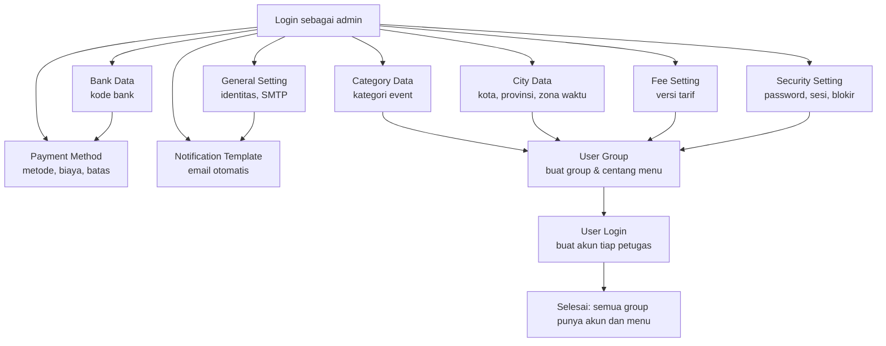

| # | Group | Module & Menu | Tindakan | Hasil yang diharapkan |
|---|---|---|---|---|
| A1 | GROUP_ADMIN | Master Data > **Category Data** | Tambah kode dan nama kategori (contoh `KONSER`, Konser) | Kategori aktif muncul di dropdown **Event Data** |
| A2 | GROUP_ADMIN | Master Data > **City Data** | Tambah kota, provinsi, dan zona (contoh `JKT`, Jakarta, WIB) | Kota aktif muncul di dropdown **Event Data** |
| A3 | GROUP_ADMIN | Master Data > **Bank Data** | Tambah kode bank 3-5 digit dan nama | Bank muncul di dropdown **Bank Account** dan **Payment Method** |
| A4 | GROUP_ADMIN | Master Data > **Payment Method** | Tambah metode (mis. QRIS), tentukan biaya dan batas minimum/maksimum | Metode aktif muncul di form **Catat Pembayaran** |
| A5 | GROUP_ADMIN | Master Data > **Fee Setting** | Buat versi baru: biaya platform, layanan, penarikan, minimum, tunggu payout, batas bayar | Tarif dipakai transaksi berikutnya |
| A6 | GROUP_ADMIN | App Setting > **General Setting** | Isi nama aplikasi, kontak, logo, dan SMTP | Email otomatis (tiket, refund) siap dipakai |
| A7 | GROUP_ADMIN | App Setting > **Notification Template** | Sesuaikan judul/isi template email tiket dan refund | Pesan otomatis sesuai kebijakan |
| A8 | GROUP_ADMIN | Security Center > **Security Setting** | Tentukan panjang password, batas gagal login, durasi blokir, batas sesi | Login dan sesi mengikuti aturan baru |
| A9 | GROUP_ADMIN | User Access > **User Group** | Buat group (mis. `GROUP_EVENT`) lalu centang menu sesuai tanggung jawab | Sidebar group terisi sesuai centric |
| A10 | GROUP_ADMIN | User Access > **User Login** | Buat akun dan pilih group | Akun dapat login dengan menu sesuai grup |

### B. Penyelenggaraan Event

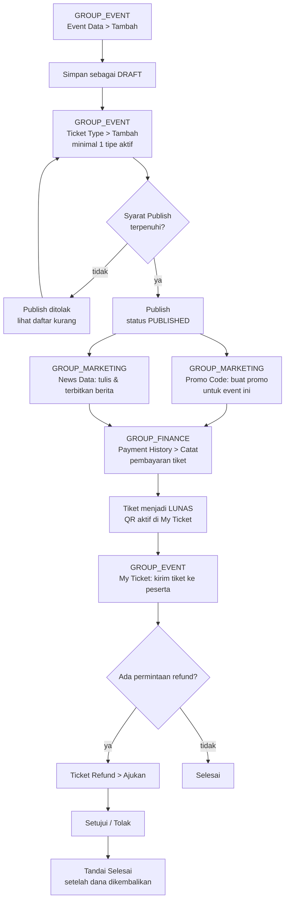

| # | Group | Module & Menu | Tindakan | Hasil yang diharapkan |
|---|---|---|---|---|
| B1 | GROUP_EVENT | Event Management > **Event Data** | **Tambah**, isi Judul/Kategori/Kota/Venue/Jadwal/Poster/Penyelenggara, **Simpan** | Event tersimpan sebagai `DRAFT` |
| B2 | GROUP_EVENT | Event Management > **Ticket Type** | Buat tipe tiket: nama, harga, kuota, batas/orang | Kuota event terisi |
| B3 | GROUP_EVENT | Event Management > **Event Data** | Klik **Publish** | Jika syarat lengkap, status menjadi `PUBLISHED` dan event muncul di **Event List** |
| B4 | GROUP_MARKETING | Marketing Tools > **Promo Code** | **Tambah** kode promo, tentukan kuota dan cakupan EVENT | Kode siap dipakai; bisa diuji dengan **Uji Kode** |
| B5 | GROUP_MARKETING | Content Management > **News Data** | Tulis berita lalu **Terbitkan** | Berita tampil di **News List** |
| B6 | GROUP_FINANCE | Transaction > **Payment History** | **Catat** > pilih Jenis **Tiket** > pilih peserta > pilih Metode > **Hitung Ringkasan** > **Simpan** | Peserta menjadi `LUNAS`, invoice terbit otomatis |
| B7 | GROUP_EVENT | Ticket Order > **My Ticket** | Buka tiket > **Kirim Ulang** atau **Unduh** | Peserta menerima QR tiket |
| B8 | GROUP_EVENT | Ticket Order > **Ticket Refund** | **Ajukan**, isi nominal dan alasan | Refund berstatus `DIAJUKAN` |
| B9 | GROUP_EVENT | Ticket Order > **Ticket Refund** | Buka detail, **Setujui** atau **Tolak** | Tiket dibatalkan dan kuota kembali (bila disetujui) |
| B10 | GROUP_FINANCE | Transaction > **Payment History** | Konfirmasi pengembalian dana pada refund **DISETUJUI** | Refund menjadi `SELESAI` |

### C. Hari Pelaksanaan

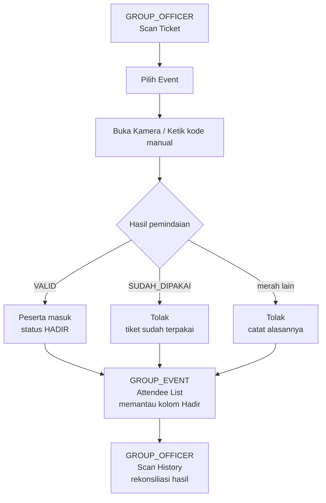

| # | Group | Module & Menu | Tindakan | Hasil yang diharapkan |
|---|---|---|---|---|
| C1 | GROUP_OFFICER | Ticket Check-in > **Scan Ticket** | Pilih **Event**, klik **Buka Kamera**, pindai QR | Layar menampilkan **VALID — silakan masuk** |
| C2 | GROUP_OFFICER | Ticket Check-in > **Scan Ticket** | Peserta tanpa QR: ketik kode pada kolom manual, klik **Cek** | Hasil sama dengan pemindaian kamera |
| C3 | GROUP_OFFICER | Ticket Check-in > **Scan Ticket** | Pindai tiket yang bukan milik event tersebut | Hasil merah **SALAH EVENT**; peserta tidak boleh masuk |
| C4 | GROUP_EVENT | Event Management > **Attendee List** | Buka event yang sama, pantau kolom **Hadir** dan **Check-in** | Kehadiran terpantau langsung |
| C5 | GROUP_OFFICER | Ticket Check-in > **Scan History** | Filter tanggal hari ini, **Export CSV** | Rekap jumlah scan, valid, dan ditolak |

### D. Merchandise

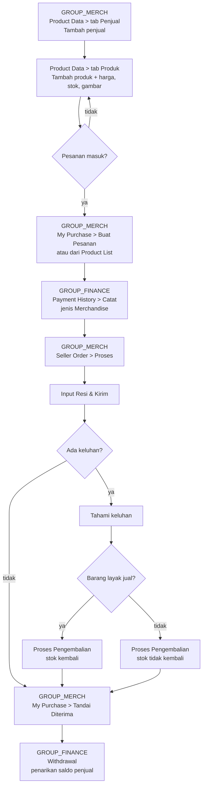

| # | Group | Module & Menu | Tindakan | Hasil yang diharapkan |
|---|---|---|---|---|
| D1 | GROUP_MERCH | Seller Center > **Product Data** (tab **Penjual**) | **Tambah** penjual: nama toko, pemilik, telepon, email, alamat | Penjual tersimpan, kode dibuat otomatis |
| D2 | GROUP_MERCH | Seller Center > **Product Data** (tab **Produk**) | **Tambah** produk: pilih penjual, nama, kategori, harga, stok, gambar | Produk tampil di katalog **Product List** |
| D3 | GROUP_MERCH | Seller Center > **Seller Order** atau Merchandise Shop > **My Purchase** | Buat pesanan (lima langkah) | Pesanan `BARU` |
| D4 | GROUP_FINANCE | Transaction > **Payment History** | **Catat** > Jenis **Merchandise** > pilih pesanan > **Simpan** | Pesanan menjadi `LUNAS` |
| D5 | GROUP_MERCH | Seller Center > **Seller Order** | Buka detail > **Proses** | Pesanan menjadi `DIPROSES` |
| D6 | GROUP_MERCH | Seller Center > **Seller Order** | **Input Resi & Kirim**, isi kurir dan resi | Pesanan menjadi `DIKIRIM`, pembeli diberi tahu |
| D7 | GROUP_MERCH | Seller Center > **Seller Order** | Buka keluhan > **Tanggapi**, isi tanggapan | Keluhan `DITANGGAPI` lalu `SELESAI` |
| D8 | GROUP_MERCH | Seller Center > **Seller Order** | **Proses Pengembalian** dan tentukan stok kembali | Pesanan `DIKEMBALIKAN`, dana tercatat refund |
| D9 | GROUP_MERCH | Merchandise Shop > **My Purchase** | **Tandai Diterima** | Pesanan menjadi `SELESAI` |
| D10 | GROUP_FINANCE | Seller Finance > **Withdrawal** | **Ajukan** penarikan atas nama penjual | Pengajuan `DIAJUKAN`, dana dikunci |

### E. Keuangan

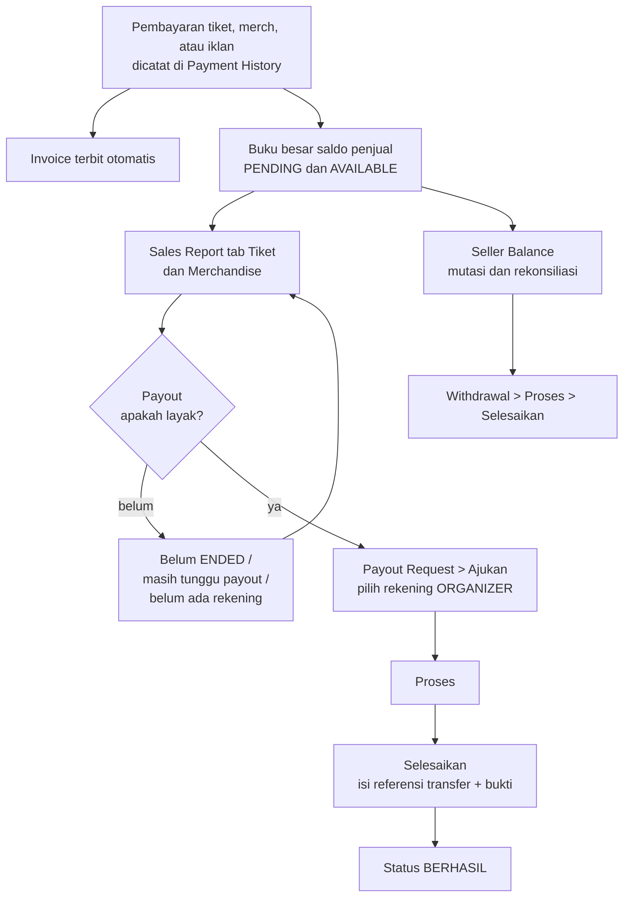

| # | Group | Module & Menu | Tindakan | Hasil yang diharapkan |
|---|---|---|---|---|
| E1 | GROUP_FINANCE | Transaction > **Payment History** | **Periksa Data** lalu **Catat** pembayaran yang tertunda | Pembayaran tercatat, invoice terbit |
| E2 | GROUP_FINANCE | Transaction > **Invoice List** | Buka detail > **Cetak** | Invoice tercetak dengan kop aplikasi |
| E3 | GROUP_FINANCE | Organizer Finance > **Sales Report** | Tab **Tiket**: pilih event, **Terapkan** | Angka bersih penyelenggara per event |
| E4 | GROUP_FINANCE | Organizer Finance > **Payout Request** | Tab **Siap Dicairkan**, klik **Ajukan**, pilih rekening | Payout `DIAJUKAN` |
| E5 | GROUP_FINANCE | Organizer Finance > **Payout Request** | Tab **Riwayat Payout** > detail > **Proses** | Payout `DIPROSES` |
| E6 | GROUP_FINANCE | Organizer Finance > **Payout Request** | Isi **No. referensi**, **Tgl transfer**, unggah **Bukti** > **Selesaikan** | Payout `BERHASIL` |
| E7 | GROUP_FINANCE | Seller Finance > **Seller Balance** | Buka mutasi; jalankan **Rekonsiliasi** | Buku besar cocok dengan pembayaran |
| E8 | GROUP_FINANCE | Seller Finance > **Withdrawal** | Buka detail > **Proses** > **Selesaikan** | Penarikan `BERHASIL`, dana keluar dari saldo |

### F. Pemantauan dan Keamanan — GROUP_ADMIN

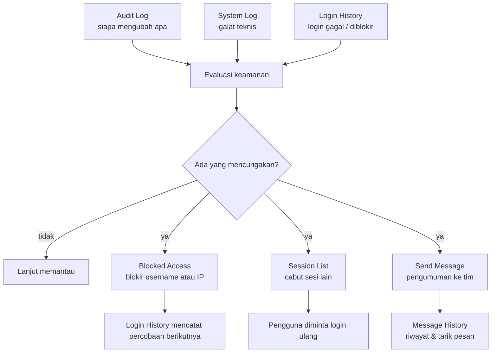

| # | Group | Module & Menu | Tindakan | Hasil yang diharapkan |
|---|---|---|---|---|
| F1 | GROUP_ADMIN | Log Center > **Audit Log** | Filter **User** atau **Halaman**, **Terapkan** | Riwayat perubahan data lengkap dengan nilai sebelum/sesudah |
| F2 | GROUP_ADMIN | Log Center > **System Log** | Filter **ERROR**, klik **Lihat detail** | Sumber dan stack trace error terlihat |
| F3 | GROUP_ADMIN | Log Center > **Login History** | Filter hasil **FAILED** atau **BLOCKED** | Terlihat akun dan IP yang gagal login |
| F4 | GROUP_ADMIN | Security Center > **Blocked Access** | **Tambah** blokir untuk username atau IP | Akses login ditolak, sesi dicabut, percobaan dicatat |
| F5 | GROUP_ADMIN | Security Center > **Session List** | Klik ikon **Cabut** pada sesi milik orang lain | Pengguna diminta login ulang |
| F6 | GROUP_ADMIN | Broadcast Message > **Send Message** | Isi judul, isi, pilih target, **Kirim** | Pesan masuk ke inbox penerima |
| F7 | GROUP_ADMIN | Broadcast Message > **Message History** | Buka detail, tarik pesan bila keliru | Pesan hilang dari inbox, riwayat tetap ada |

### 9.1 Diagram Status

**Status Event**

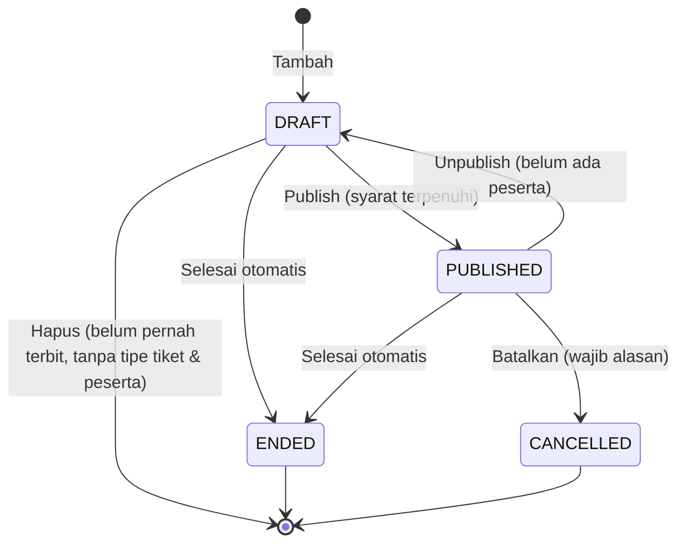

**Status Tiket dan Kehadiran**

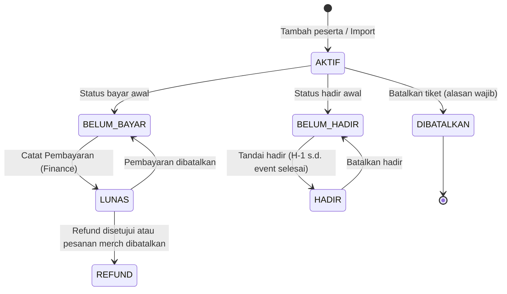

**Status Refund Tiket**

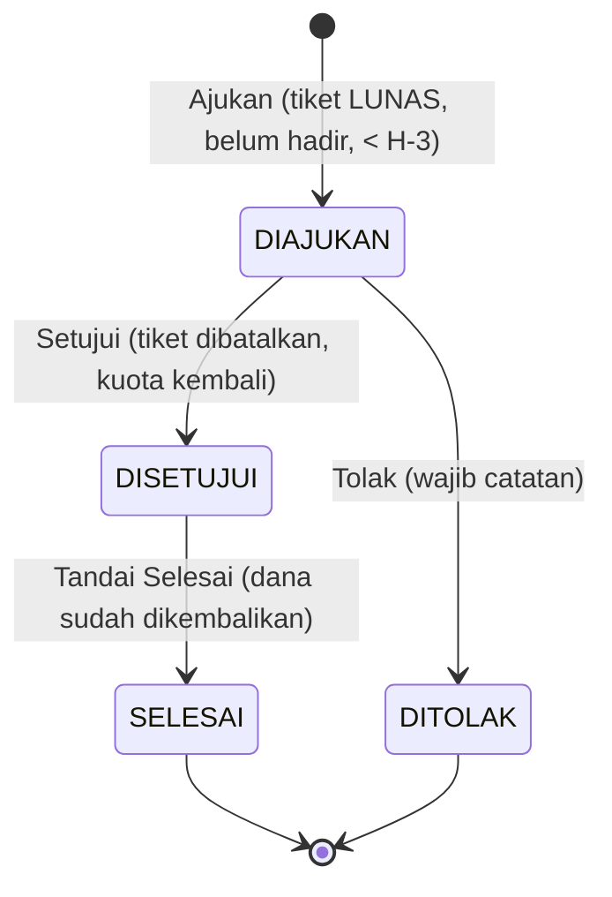

**Status Pesanan Merchandise**

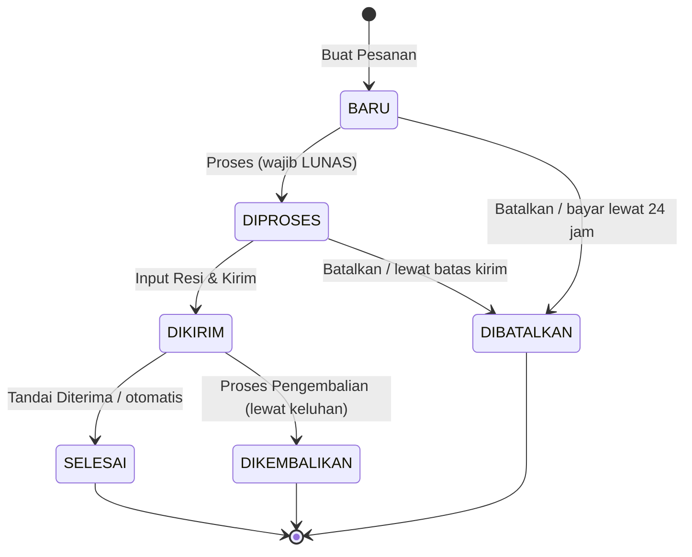

**Status Pembayaran**

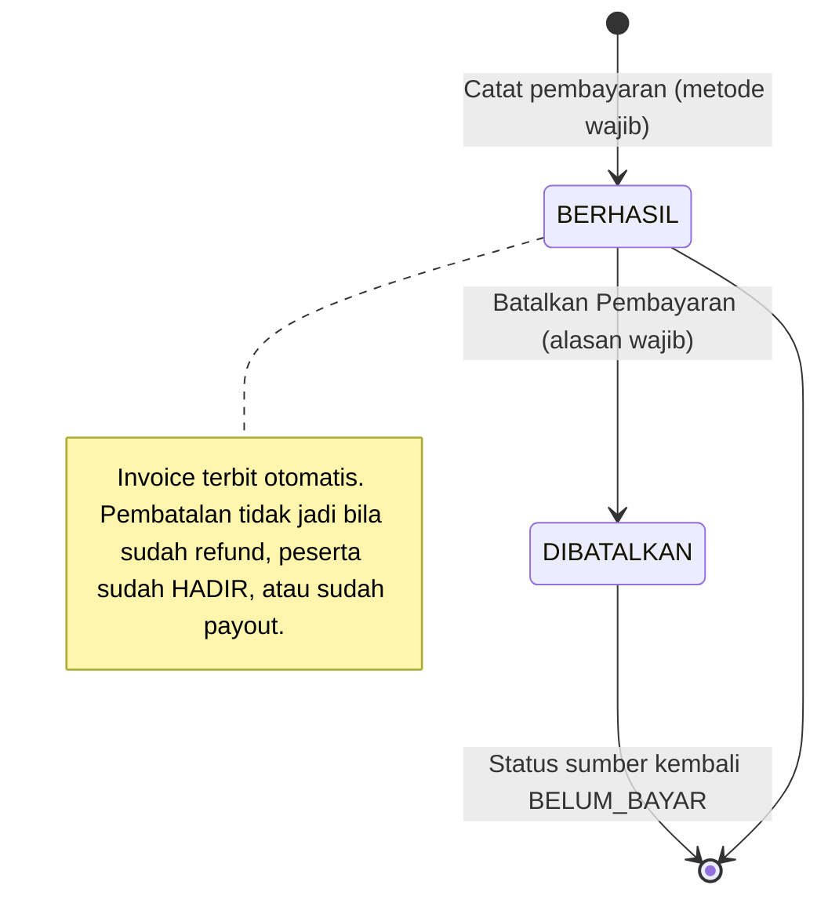

**Status Iklan (Ad Campaign)**

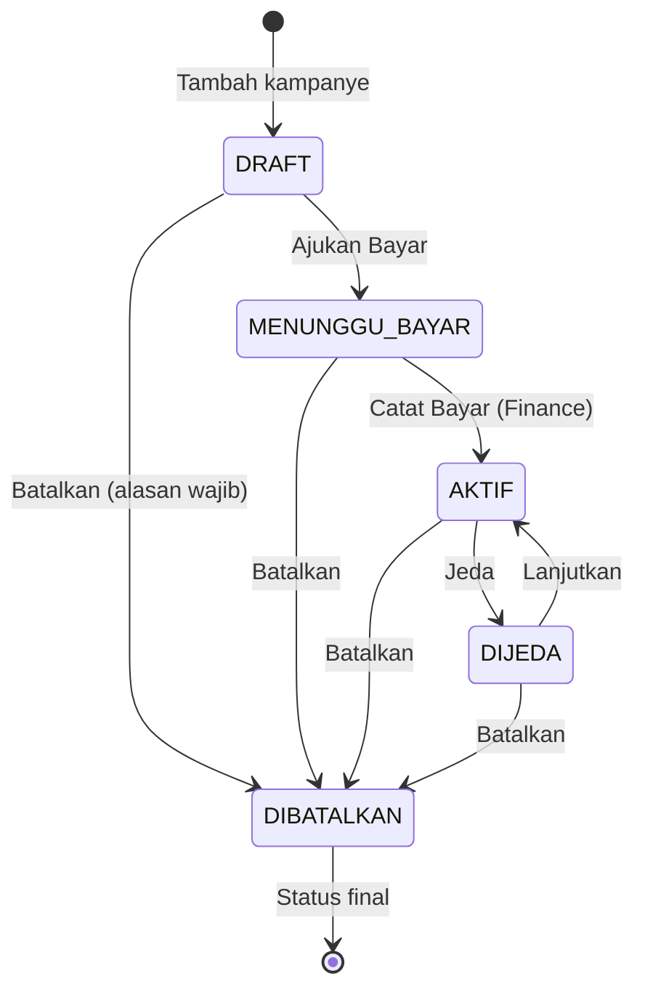

**Status Withdrawal dan Payout**

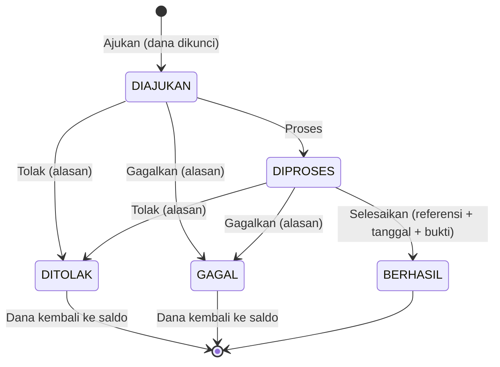

**Status Berita**

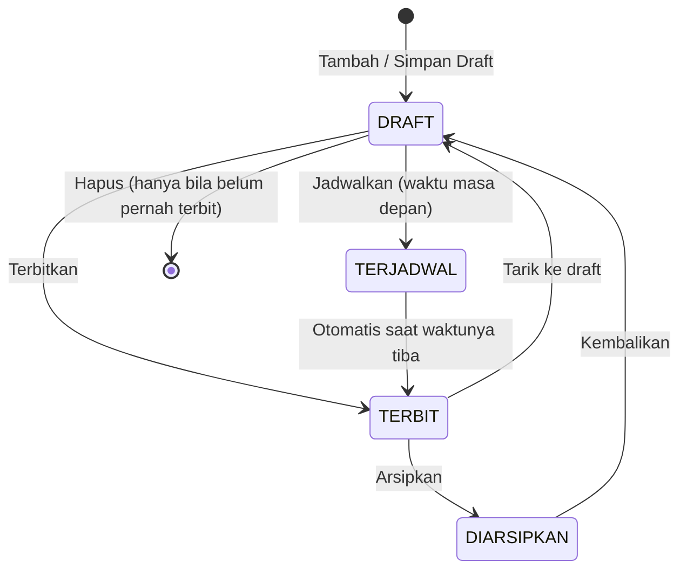

---

## 10. Temuan dan Catatan

Bagian ini berisi hasil pengujian langsung terhadap aplikasi pada 3 Oktober 2026.
Semua butir di bawah ini **tidak diperbaiki** sesuai instruksi; hanya dicatat.

### 10.1 Perbedaan antara rencana dan kenyataan

| No | Temuan | Dampak |
|---|---|---|
| 1 | **Tampilan untuk pembeli belum ada.** Tidak ada halaman katalog publik, pencarian tiket, checkout, maupun pembayaran dari sisi pembeli. Modul Discovery adalah katalog baca-saja untuk staff internal. | Manual ini hanya mencakup sisi admin dan operator. |
| 2 | **Semua 47 menu sudah tersedia.** Tidak ada menu yang berlabel "Belum tersedia". | Tidak ada menu yang perlu ditandai belum jadi. |
| 3 | Nama menu **Login History** di sistem memakai kode internal `cp_loginhistory`, bukan `cp_loginlog`. | Nama di layar tetap **Login History**; kode internal tidak tampil ke pengguna. |
| 4 | Group `GROUP_SUPPORT` (**Support**) sudah ada di sistem tetapi tidak punya akun dan tidak punya akses menu, sehingga tidak muncul di sidebar. | Tidak dijelaskan sebagai group aktif di manual ini. |
| 5 | Halaman **Ticket Type** dan **Attendee List** tidak bisa dibuka tanpa memilih event lebih dulu. Keduanya mengambil event dari daftar (**Pilih event**) atau dibuka langsung dari tombol pintas pada **Event Data**. |Hal ini perlu dijelaskan pada langkah RELATED untuk kedua menu tersebut. |
| 6 | Tombol **Buat Pesanan** pada **Product List** dan **My Purchase** hanya dapat dibuat setelah produk dan penjual dipilih. | Alur pemesanan merch selalu dimulai dari produk atau halaman My Purchase. |
| 7 | **Module List** dan **Menu List** tidak memiliki tombol Tambah maupun Hapus. Kode modul, kode menu, induk, dan control tidak dapat diubah dari aplikasi. | Struktur modul dan menu hanya bisa diubah oleh AgreementQkrokoko developer. |
| 8 | Halaman **Audit Log**, **System Log**, **Login History**, **Scan History**, **Invoice List**, **Sales Report**, **Seller Balance**, dan **Module System > User Login** bersifat baca-saja. | Pengguna tidak dapat memperbaiki data dari halaman tersebut. |
| 9 | Grafik pada halaman **Event by City** memakai judul yang sama dengan **Event by Category**, yaitu "Event per kategori" dan "Tiket terjual per kategori", meskipun isinya per kota. | Tercatat sebagai keanehan teks pada bagian 10.3. |
| 10 | **Fee Setting** menyimpan setiap perubahan sebagai versi baru; tidak ada tombol ubah versi lama. | Perubahan tarif tidak mengubah transaksi lama. |

### 10.2 Perbedaan antara akses di database dan menu di sidebar

| Pengujian | Hasil |
|---|---|
| Login keenam akun (`admin`, `event`, `officer`, `merch`, `marketing`, `finance`) | Berhasil; jumlah menu di sidebar cocok dengan data akses: 19 / 11 / 2 / 5 / 8 / 7. |
| Baronya menu **Home** | Muncul di sidebar `event`, `merch`, dan `marketing` sesuai data akses. |
| Baronya modul **Module System** | Hanya muncul pada `admin`. |
| Menu di luar daftar grup | Ditolak dengan pesan **"Anda tidak memiliki hak akses untuk membuka menu ini."** (dihasilkan pada semua pengujian). |
| Jumlah baris akses di database | Lebih besar daripada jumlah menu karena setiap grup mewarisi baris **menu induk** (misalnya *Event Catalog* dan *Info Center*). Ini perilaku yang benar agar menu anak tampil. |
| **Menu List** menampilkan kolom **Akses** berisi jumlah grup yang punya akses. | Konsisten dengan data akses. |

### 10.3 Langkah yang gagal atau janggal saat dicoba (tidak diperbaiki)

| No | Langkah yang dicoba | Hasil yang muncul | Perkiraan penyebab |
|---|---|---|---|
| 1 | Membuka **Module System > Master Data > City Data** dan melihat kolom status aktif | Nama kolom status di tabel dan form adalah `CATACTIVE`, sementara data yang dikirim backend bernama `CITYACTIVE`. Nama field berbeda antarafrontend dan backend. |ianus yangan-encoded. |
| 2 | Membuka **Module System > Master Data > City Data**, lalu memakai filter kolom **Aktif** | Filter mungkin tidak bekerja optimal karena perbedaan nama kolom tersebut (lihat butir 1). | Consekuensi butir 1. |
| 3 | Membuka **Event by City** | Grafik dan pesan kosong memakai kata **"kategori"** (judul grafik "Event per kategori", pesan "Belum ada kategori untuk filter ini") padahal isinya per **kota**. | Judul dan pesan di frontend disalin dari halaman Event by Category. |
| 4 | Membuka **Event by City**, menyaring dengan rentang tanggal di mana tidak ada event | Pesan kosong berbunyi **"Belum ada kategori untuk filter ini."** | Sama seperti butir 3. |
| 5 | Meminta halaman **Audit Log** untuk menampilkan data contoh | Catatan **"CATCODE ZZ"** milik probing/testing muncul di riwayat (LOGID 207). Catatan ini **tidak dapat dihapus** dari sistem. | Pengujian manual saat penyusunan dokumen; penghapusan ditolak oleh database. |
| 6 | Membuka **Finance > Bank Account** | Tombol **Export CSV** dan fitur kunci/API tidak ada di halaman ini. | Kode banking’s application hanya menyediakan pengelolaan rekening, bukan ekspor. |
| 7 | Membuka **Finance > Invoice List**, **Sales Report**, dan **Scan History** | Tombol **Export CSV** tersedia, tetapi **Cetak** hanya ada pada **Invoice List** (via `window.print()`) dan **Sales Report**; **Scan History** tidak punya tombol cetak. | Bawaan masing-masing halaman. |
| 8 | Membuka **Module System > User Login** lalu membuat akun tanpa mengisi kolom | Pesan **"Username dan Password wajib diisi."** | Validasi backend bekerja seperti seharusnya. |
| 9 | Membuka **Module Marketing > Promo Code** dan mencoba **`Uji Kode`** dengan kode yang tidak ada | Pesan hasil uji **"Tidak berlaku (KODE_TIDAK_ADA)"**. | Validasi normal, bukan kerusakan. |

### 10.4 Hal yang perlu diputuskan atau dilengkapi sebelum manual dibagikan

1. **Judul grafik dan pesan kosong pada Event by City** masih menyebut "kategori". Perlu diputuskan apakah akan diperbaiki di aplikasi atau dibiarkan dengan catatan pada manual.
2. **Perbedaan nama kolom status pada City Data** (`CATACTIVE` di frontend, `CITYACTIVE` di backend). Perlu ditinjau apakah filter kolom **Aktif** benar-benar bekerja.
3. **Tampilan untuk pembeli** belum ada. Bila aplikasi ditujukan juga ke publik, perlu manual terpisah untuk pembeli.
4. **Password akun demo** (`admin`, `event`, `officer`, `merch`, `marketing`, `finance`) sengaja lemah dan hanya untuk pengujian.
5. Beberapa menu belum memiliki alathcetak PDF (Invoice hanya relies pada print browser). Bila dibutuhkan arsip, perlu tambahan panduan.
6. **Group `GROUP_SUPPORT`** masih ada tanpa akun dan tanpa akses. Perlu diputuskan apakah group ini akan dipakai atau dihapus olehCONSTRAH developer.
7. Beberapa halaman System belum memiliki pemeriksaan akses di sisi server; lihat 10.5.
8. **Screenshot** pada manual ini belum tersedia. Penanda `[Tangkapan layar: ...]` perlu diisi oleh tim dokumentasi.

### 10.5 Peringatan keamanan

1. **Password akun demo wajib diganti sebelum production.** Kelima akun baru dibuat dengan password yang sama dengan username (misalnya `event` / `event`) dan sengaja tidak memenuhi kebijakan password di **Security Setting**. Password diberikan terpisah oleh tim pengembang.
2. **Tiga halaman Module System belum memeriksa akses di sisi server.** Halaman **User Login**, **Module List**, dan **Bank Data** tidak memiliki pemeriksaan hak akses pada endpoint-nya. Menu tersebut tidak muncul di sidebar akun non-admin dan antarmuka memblokirnya, tetapi request langsung ke endpoint dari akun non-admin **tidak ditolak** (mengembalikan `success: true`). Menu **Menu List**, **Category Data**, **City Data**, **Payment Method**, **Fee Setting**, **Audit Log**, **System Log**, dan **Login History** punya kondisi serupa. Perbaikan memerlukan perubahan kode dan berada di luar cakupan pekerjaan dokumentasi ini. Sampai diperbaiki, pastikan hanya akun admin yang mengetahui alamat endpoint tersebut.
3. **Nomor rekening tersimpan dalam bentuk terenkripsi** dan hanya 4 digit terakhir yang tampil di antarmuka. Membuka nomor penuh selalu dicatat di **Audit Log**.
4. **Data pribadi peserta disamarkan** pada Audit Trail dan System Log (email dan telepon disamarkan sebagian).
5. **Catatan Audit Log tidak dapat dihapus**, termasuk oleh database. Hal ini memastikan jejak audit tetap terjaga.
6. **Kunci QR tiket dan nomor rekening** bergantung pada variabel konfigurasi (`QR_SECRET` dan `FINANCE_HASH_SECRET`). Bila kunci tersebut belum diisi, sistem menolak pembuatan QR atau pengelolaan rekening demi keamanan.
7. **Blokir otomatis** aktif setelah beberapa kali gagal login sesuai **Security Setting**. Admin dapat membuka blokir melalui **Blocked Access**.

---

*Dokumen ini dibuat berdasarkan kode dan data aplikasi yang benar-benar ada pada 3 Oktober
2026. Bila aplikasi berubah, perbarui manual ini agar tetap sesuai.*